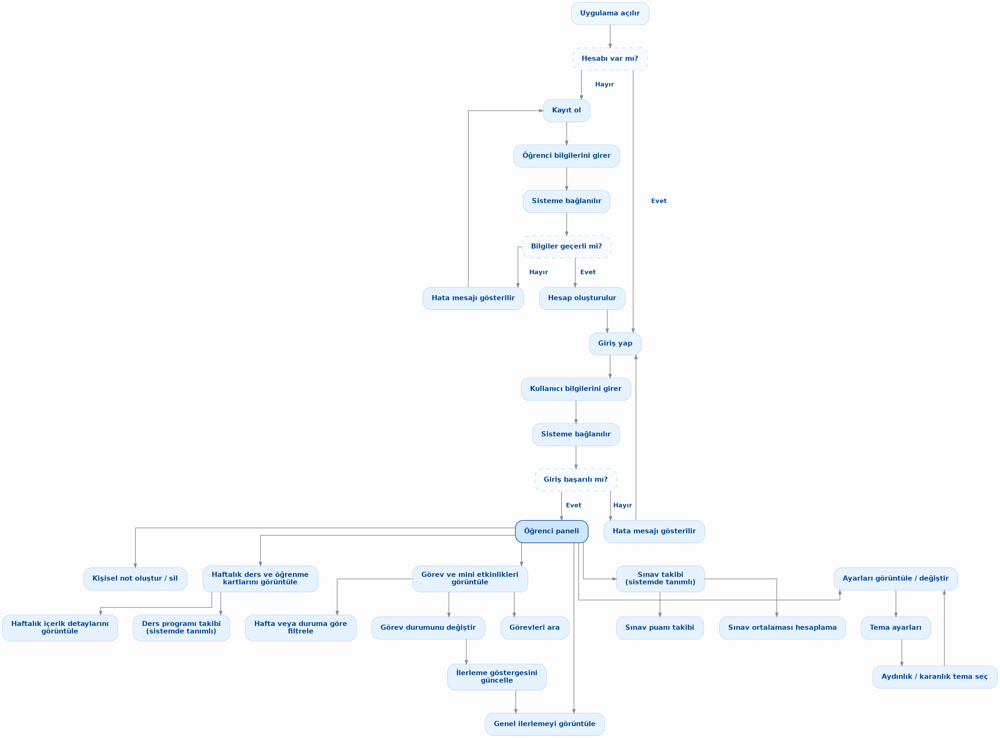
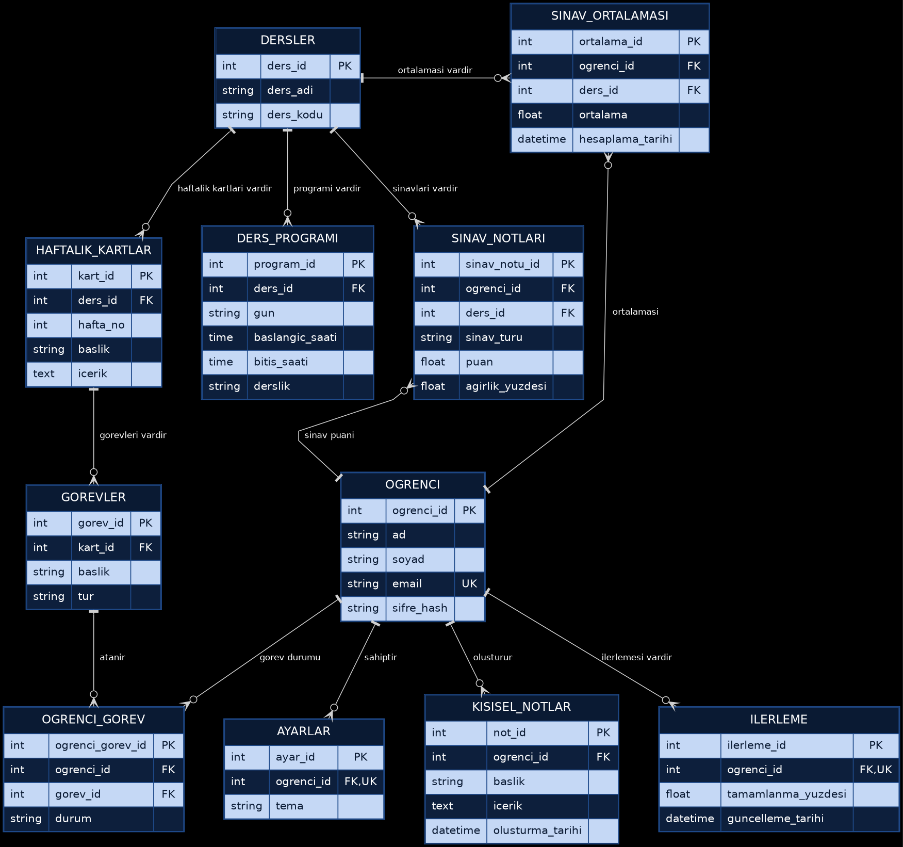

# Edutrack (AkademiX) – Etkileşimli Ders Deneyimi Panosu

**Karadeniz Teknik Üniversitesi (KTÜ) • Yazılım Mühendisliği Bölümü**  
**Yazılım Geliştirme Dersi – Proje 1 (Grup 4)**

**Edutrack (AkademiX)**, öğrencilerin haftalık ders içeriklerini, öğrenme hedeflerini, görev ve mini etkinliklerini, haftalık ders programlarını, KTÜ mevzuatına uygun sınav/AGNO hesaplamalarını ve kişisel çalışma notlarını modern, erişilebilir ve duyarlı (responsive) bir web arayüzünden takip edebilmelerini sağlayan etkileşimli bir öğrenci başarı platformudur.

---

## 👥 Grup Üyeleri ve Rolleri (Grup 4)

| Öğrenci No | Adı Soyadı | Projedeki Rolü | Üstlendiği Modüller ve Sorumluluklar |
| :--- | :--- | :--- | :--- |
| **444090** | **Nilay Sezin Yalçın** | **Proje Lideri & Geliştirici** | Ekip koordinasyonu, proje mimari iskeleti, duyarlı (responsive) arayüz tasarımı, başlatıcı betikler ve sürüm kontrol düzeni |
| **444083** | **Oğuzhan İnce** | **Sistem Analisti & Geliştirici** | İhtiyaç analizi, 17 FR ve 10 NFR gereksinim dökümleri, 11 tablolu ilişkisel ER veri modeli, gereksinim-test izlenebilirlik matrisi |
| **444082** | **İsmail Korkmaz** | **Test / Kalite Sorumlusu & Geliştirici** | Otomatik kabul testleri (`tests.js`), kalite güvencesi raporu, `localStorage` veri kalıcılığı, KTÜ BDS/MDS not motoru ve AI asistan entegrasyonu |
| **444101** | **Onur Uzun** | **Dokümantasyon / Sunum Sorumlusu & Geliştirici** | Görev arama ve filtreleme motoru, form doğrulama kontrolleri, kullanıcı dokümanı, teknik proje raporu, README ve proje sunumu |

*Not: Tüm grup üyeleri kendi uzmanlık rollerinin yanı sıra aktif olarak kod geliştirme, hata giderme (bug-fix) ve GitHub süreçlerine katkıda bulunmuştur.*

---

## 🛠️ Kullanılan Teknolojiler

* **İstemci Tarafı (Frontend):** HTML5 (Semantik yapı, ARIA erişilebilirlik nitelikleri), CSS3 (CSS Custom Properties / Değişkenler, CSS Grid, Flexbox, Medya Sorguları), Vanilla JavaScript (ES6+)
* **Veri Kalıcılığı:** Web Storage API (`localStorage` ile görevler, kişisel notlar, ders programı, AGNO tablosu ve tema tercihlerinin tarayıcıda saklanması)
* **Erişilebilirlik (a11y) & Kalite Güvencesi:** WCAG AA kontrast uyumluluğu (≥ 4.5:1), klavye navigasyonu (`Tab`, `Enter`, `Space`, `Escape`), gerçek DOM üzerinde çalışan 17 senaryoluk otomatik kabul testi koşucusu (`src/js/tests.js`)
* **Yapay Zekâ Danışmanı:** Çevrimdışı çalışan dahili KTÜ kural motoru (`⚡ Yerel Motor`) ve isteğe bağlı kullanıcı tanımlı Google Gemini / OpenAI API bağlantısı
* **Yerel Sunucu ve Otomasyon:** Python 3 (`http.server` tabanlı `server.py`), Windows Toplu İş Betiği (`baslat_windows.bat`), POSIX Kabuk Betiği (`baslat.sh`)
* **Sürüm Kontrolü ve İşbirliği:** Git & GitHub (Issue takibi, görev bazlı commit geçmişi)

---

## ✨ Temel Özellikler

1. **Kayıt, Giriş ve Hızlı Demo Oturumu:** Öğrenci numarası veya KTÜ e-postası ile kayıt/giriş simülasyonu ve tek tıkla **Hızlı Demo Girişi**.
2. **Genel İlerleme Göstergesi ve Canlı Sayaçlar:** Tamamlanan görev oranına göre anlık güncellenen ilerleme çubuğu (`%`) ve tıklanabilir 4 istatistik kartı (*Toplam Görev*, *Tamamlanan*, *Devam Eden*, *Yüksek Öncelik*).
3. **Haftalık Ders ve Öğrenme Kartları:** 4 haftalık ders akışını özetleyen etkileşimli kartlar; her karta tıklandığında ilgili haftanın öğrenme hedeflerini ve görevlerini gösteren detay penceresi (modal) ile açılır/kapanır canlı görev kartları çekmecesi.
4. **Görev ve Mini Etkinlik Yönetimi:**
   * Yeni görev ekleme, görev tamamlama (`checkbox`) ve görev silme.
   * **Form Doğrulama (Validation):** Boş veya yalnızca boşluk karakterlerinden oluşan görev başlıklarını engelleyen ve başlık alanının altında anlaşılır uyarı mesajı gösteren doğrulama kontrolü.
   * **XSS Güvenliği:** Kullanıcı girdilerinin (`<script>`, `` vb.) HTML kaçışından (`escapeAiHtml`) geçirilerek güvenli düz metin olarak işlenmesi.
5. **Türkçe Duyarlı Anlık Arama ve Çoklu Filtreleme:**
   * Görev başlığı, açıklama ve kategori üzerinde Türkçe büyük/küçük harf (`İ/i`, `I/ı`) duyarlı anlık arama.
   * Eşleşen görev bulunamadığında görev listesi alanında `"Aramanızla eşleşen görev bulunamadı"` bilgilendirme mesajının gösterilmesi ve filtre temizlendiğinde otomatik gizlenmesi.
   * Durum (*Tümü*, *Devam Eden*, *Tamamlanan*, *Yüksek Öncelik*) ve hafta (*1-4. Hafta*) bazlı kombine filtreleme.
6. **KTÜ AGNO ve Not Simülatörü (30 Kişi Kuralı):**
   * Sınıf mevcudu `< 30` için **Mutlak Değerlendirme Sistemi (MDS)**, `≥ 30` için **Bağıl Değerlendirme Sistemi (BDS / Çan Eğrisi)** hesaplaması.
   * KTÜ **Final 50 Barajı** kontrolü (Final < 50 ise doğrudan `FF`) ve vize, final, laboratuvar, proje, ödev, quiz ağırlıklarına göre dönem AGNO hesaplaması.
7. **Haftalık Ders Programı ve Kişisel Çalışma Notları:**
   * Gün, saat, ders adı ve derslik bilgisiyle haftalık ders programı oluşturma ve silme.
   * Oturumlar arası kalıcı (`localStorage`) kişisel çalışma notu ekleme ve silme.
8. **Aydınlık / Karanlık Tema ve Tam Erişilebilirlik:**
   * Tek tıkla Aydınlık (`☀️`) ve Karanlık (`🌙`) mod geçişi ve tercih kalıcılığı.
   * Mobil (`320px - 375px`), tablet (`768px`) ve masaüstü (`1280px+`) ekranlarda yatay taşma olmadan tam duyarlı (responsive) görünüm.
9. **AkademiX AI Danışmanı (Yerel Kural Motoru + İsteğe Bağlı API):**
   * Depoda herhangi bir gizli API anahtarı **bulunmaz** (NFR-07). Asistan varsayılan olarak hiçbir anahtar gerektirmeden yerel KTÜ kural motoruyla çalışır.
   * İsteyen kullanıcılar sağ alttaki asistan penceresinden **⚙️ (API Ayarları)** menüsünü açarak kendi Google Gemini veya OpenAI API anahtarlarını yalnızca kendi tarayıcılarında (`localStorage`) saklanmak üzere tanımlayabilir.

---

## 🚀 Kurulum Adımları

Projeyi temiz bir ortamda bilgisayarınıza kurmak için aşağıdaki adımları izleyin:

### 1. Ön Koşullar
* Modern bir web tarayıcısı (Google Chrome, Microsoft Edge, Mozilla Firefox veya Safari).
* *(İsteğe bağlı – yerel sunucu için)* **Python 3.x** veya **Node.js**. Bilgisayarınızda Python veya Node.js kurulu olmasa dahi uygulama doğrudan dosya üzerinden (`src/index.html`) çalışabilmektedir.

### 2. Repository'yi Klonlayın
```bash
git clone https://github.com/nilaysezinyalcin-collab/Edutrack.git
cd Edutrack
```

---

## 💻 Çalıştırma Talimatları

Uygulamayı işletim sisteminize ve tercihinize göre aşağıdaki yöntemlerden biriyle başlatabilirsiniz:

### Yöntem 1: Windows Kullanıcıları İçin
* **Tek Tıkla Başlatıcı:** Proje kök dizinindeki **`baslat_windows.bat`** dosyasına çift tıklayın. Betik bilgisayarınızda çalışan bir Python veya Node.js kurulumu varsa `http://localhost:5173` üzerinde yerel sunucuyu başlatır; yoksa `src/index.html` dosyasını doğrudan varsayılan tarayıcınızda açar.
* **Terminal (PowerShell / CMD) ile:**
  ```powershell
  python server.py
  ```
  *(Python `py` başlatıcısı ile kuruluysa `py server.py` komutunu kullanabilirsiniz.)*

### Yöntem 2: macOS ve Linux Kullanıcıları İçin
* **Otomatik Betik ile:**
  ```bash
  chmod +x baslat.sh
  ./baslat.sh
  ```
* **Terminal ile:**
  ```bash
  python3 server.py
  ```

### Yöntem 3: Sunucusuz (Sıfır Kurulum) Çalıştırma
Herhangi bir terminal veya yerel sunucu kullanmadan doğrudan **`src/index.html`** dosyasına çift tıklayarak uygulamayı tarayıcınızda açabilirsiniz.

---

## 🎯 Demo Bilgisi ve Canlı Test Koşucusu

### 1. Uygulama Giriş ve Demo Bilgileri
Yerel sunucu başlattıysanız tarayıcınızda **`http://localhost:5173`** adresini (sunucusuz çalıştırdıysanız `src/index.html` dosyasını) açın:
* **Hızlı Demo Girişi:** Giriş ekranındaki **"⚡ Hızlı Demo Girişi (İsmail Korkmaz - 444082)"** butonuna tıklayarak şifre girmeden doğrudan öğrenci paneline geçebilirsiniz.
* **Manuel Demo Girişi:**
  * **Öğrenci No / E-Posta:** `444082` veya `ismail@ktu.edu.tr`
  * **Şifre:** `123456`
* **Yeni Kayıt:** **"Kayıt Ol"** sekmesinden yeni bir öğrenci numarası ve e-posta ile hesap oluşturabilirsiniz.

### 2. Otomatik Kabul Testlerini Çalıştırma (17 Test Senaryosu)
Uygulamanın gerçek DOM ve iş mantığı üzerinde çalışan 17 otomatik kabul testini (`TC-01` – `TC-17`) çalıştırmak için:
* **Sunucu üzerinden:** `http://localhost:5173/test-runner.html` veya `http://localhost:5173/index.html?test=1`
* **Dosya üzerinden:** `src/test-runner.html` dosyasını tarayıcıda açın.
*(Test koşucu mevcut `localStorage` verilerinizi yedekler, 17 testi koşturup sonuç tablosunu ekranda gösterir ve verilerinizi eksiksiz geri yükler.)*

---

## 🖼️ Ekran Görüntüleri ve Sistem Diyagramları

Projeye ait mimari akış şeması ve veritabanı ER diyagramı `docs/` dizininde yer almaktadır:

### 1. Uygulama Akış Diyagramı


### 2. Veritabanı ER Diyagramı (11 Tablolu İlişkisel Şema)


### 3. Uygulama Ekranları Özeti
* **Giriş ve Kayıt Ekranı (`#auth-section`):** Sekmeli giriş/kayıt formları, doğrulama mesajları ve Hızlı Demo Girişi.
* **Dönem İlerlemesi ve Canlı Sayaçlar (`#student-portal-app`):** Yüzdelik ilerleme çubuğu ve duruma göre filtreleme yapan 4 renkli istatistik kartı.
* **4 Haftalık Ders Kartları ve Detay Modalı (`#weeks-modules-grid`):** Haftalık öğrenme kazanımları ve o haftaya ait görevlerin listelendiği etkileşimli pencereler.
* **Görev Yönetimi, Arama ve Filtreleme (`#tasks-section`):** Türkçe karakter duyarlı arama çubuğu, boş arama sonucu uyarısı, hafta/durum filtreleri ve başlık doğrulamalı görev ekleme penceresi.
* **KTÜ AGNO Simülatörü, Ders Programı ve Kişisel Notlar (`.side-stack`):** 30 kişi kuralı (MDS/BDS) hesaplama sihirbazı, haftalık ders programı tablosu ve kalıcı çalışma notları.

---

## 📂 Proje Dizin Yapısı

```text
Edutrack/
├── src/                                  # Uygulama kaynak kodları (Tek giriş noktası)
│   ├── index.html                        # Ana uygulama arayüzü (Giriş + Öğrenci Paneli + Modallar)
│   ├── test-runner.html                  # Otomatik kabul testleri yönlendirici ve başlatıcısı
│   ├── css/
│   │   └── style.css                     # Duyarlı (responsive) tasarım, aydınlık/karanlık tema ve bileşen stilleri
│   └── js/
│       ├── portal.js                     # Ana uygulama mantığı (Görevler, filtre/arama, AGNO, notlar, AI asistan)
│       ├── a11y.js                       # Erişilebilirlik yardımcıları (ARIA etiketleri, klavye navigasyonu, Esc)
│       └── tests.js                      # Gerçek uygulama üzerinde çalışan 17 otomatik kabul testi (TC-01..TC-17)
│
├── docs/                                 # Teknik dokümantasyon, raporlar ve kalite güvence belgeleri
│   ├── README.md                         # Dokümanlar dizini rehberi
│   ├── kullanici-dokumani.pdf            # Adım adım son kullanıcı kullanım kılavuzu (PDF)
│   ├── kullanici-dokumani.md             # Kullanıcı kullanım kılavuzu kaynak metni (Markdown)
│   ├── proje-raporu.pdf                  # Kapsamlı teknik proje raporu (PDF)
│   ├── proje-raporu.md                   # Teknik proje raporu kaynak metni (Markdown)
│   ├── test-senaryolari.md               # Otomatik (TC) ve manuel (MT) test senaryoları ve sonuç raporu
│   ├── gereksinim-test-eslestirme.md     # Gereksinim (FR/NFR) – Test izlenebilirlik matrisi
│   ├── er_diyagram_v2.png                # 11 tablolu ilişkisel veritabanı ER diyagramı
│   ├── ogrenci_paneli_diyagram_mavi.png  # Sistem ve uygulama akış diyagramı
│   ├── ISMAIL_KORKMAZ_YANSITMA_RAPORU.md # Bireysel yansıtma raporu (Markdown & .docx)
│   └── ISMAIL_KORKMAZ_AKRAN_DEGERLENDIRME.md # Akran değerlendirme formu (Markdown & .docx)
│
├── presentation/                         # Proje sunum dosyaları
│   ├── README.md                         # Sunum klasörü açıklaması
│   ├── sunum.pptx                        # Proje 1 final sunumu (PowerPoint)
│   ├── sunum.pdf                         # Proje 1 final sunumu (PDF)
│   └── sunum.md                          # Proje 1 sunum içeriği ve demo akışı (Markdown)
│
├── server.py                             # src/ dizinini http://localhost:5173 üzerinden sunan Python HTTP sunucusu
├── baslat_windows.bat                    # Windows için yerel sunucu / tarayıcı başlatıcı betik
├── baslat.sh                             # macOS ve Linux için yerel sunucu / tarayıcı başlatıcı betik
├── .gitattributes                        # Satır sonu (CRLF/LF) yapılandırması
└── README.md                             # Proje tanıtım, kurulum ve kullanım kılavuzu
```

---

## ⚠️ Bilinen Eksikler ve Sınırlamalar

1. **Tarayıcı Bazlı Veri Saklama (`localStorage`):** Proje 1 kapsamında arka uç (backend) ve merkezi veritabanı sunucusu zorunlu olmadığından tüm veriler kullanıcının kendi tarayıcısında (`localStorage`) tutulur. Tarayıcı önbelleği temizlendiğinde veya farklı bir cihaz/tarayıcıdan girildiğinde veriler varsayılan başlangıç durumuna döner.
2. **İstemci Tarafı Kimlik Doğrulama Simülasyonu:** Giriş ve kayıt ekranı istemci tarafında simüle edilmektedir; gerçek bir sunucu tabanlı oturum veya şifre kriptolama servisi Proje 2 / Proje 3 aşamalarında merkezi veritabanı ile entegre edilecektir.
3. **Çevrimiçi Yapay Zekâ Modu İçin Kullanıcı Anahtarı Gereksinimi:** Güvenlik standartları (NFR-07) gereği depoda gömülü API anahtarı bulunmamaktadır. Canlı Gemini veya OpenAI yanıtları almak isteyen kullanıcıların kendi API anahtarlarını arayüzdeki ayarlar penceresinden girmeleri gerekir; anahtar girilmediğinde dahili çevrimdışı kural motoru hizmet verir.
4. **Tarayıcı Test Kapsamı:** Otomatik kabul testleri Chromium tabanlı tarayıcılarda (Chrome, Edge) doğrulanmıştır; farklı tarayıcı motorlarında (Firefox, WebKit/Safari) manuel doğrulama yapılması önerilir.
