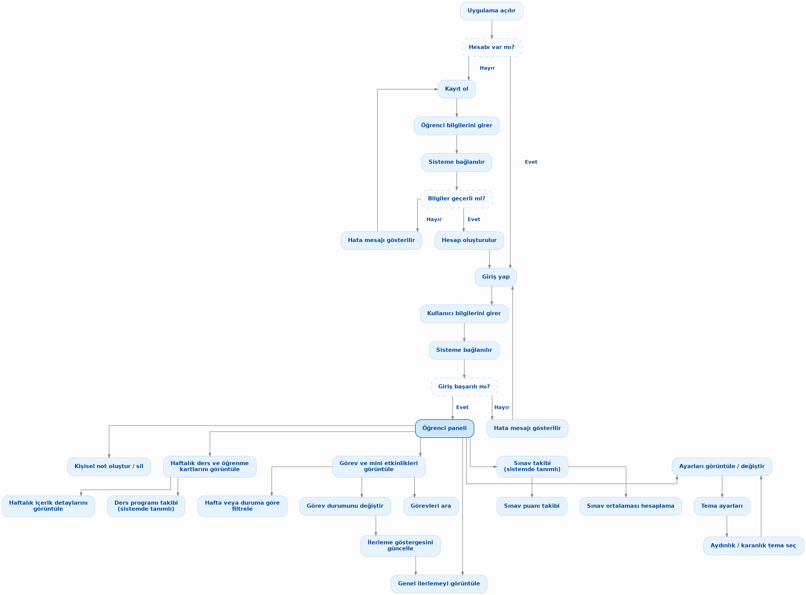

# Edutrack (AkademiX) – Kullanıcı Dokümanı ve Uygulama Kılavuzu

**Karadeniz Teknik Üniversitesi (KTÜ) • Fen Fakültesi • Yazılım Geliştirme Bölümü**  
**Yazılım Geliştirme Dersi – Proje 1 (Grup 4)**  
**Sürüm:** 1.0 • **Tarih:** Kasım 2026

---

## 1. Giriş ve Genel Bakış

**Edutrack (AkademiX – Etkileşimli Ders Deneyimi Panosu)**, üniversite öğrencilerinin dönem boyunca haftalık ders konularını, öğrenme hedeflerini, görev ve mini etkinliklerini, haftalık ders programlarını, KTÜ sınav ve AGNO hesaplamalarını ve kişisel çalışma notlarını tek bir ekrandan takip edebilmeleri için geliştirilmiş modern bir web uygulamasıdır.

Bu kılavuz, uygulamayı ilk kez açan bir kullanıcının tüm özellikleri adım adım ve sorunsuz biçimde kullanabilmesi amacıyla hazırlanmıştır.

---

## 2. Uygulamayı Başlatma

Uygulamayı bilgisayarınızda çalıştırmak için üç farklı yöntemden birini tercih edebilirsiniz:

1. **Windows Tek Tıkla Başlatma:** Proje klasöründeki `baslat_windows.bat` dosyasına çift tıklayın. Tarayıcınızda otomatik olarak `http://localhost:5173` adresi açılacaktır.
2. **macOS / Linux veya Terminal ile Başlatma:** Proje klasöründe `./baslat.sh` veya `python server.py` komutunu çalıştırın ve tarayıcınızdan `http://localhost:5173` adresine gidin.
3. **Sunucusuz Doğrudan Açma:** Herhangi bir ek yazılıma ihtiyaç duymadan `src/index.html` dosyasına çift tıklayarak uygulamayı doğrudan tarayıcınızda açabilirsiniz.

---

## 3. Kayıt Olma ve Giriş Yapma

Uygulama açıldığında kullanıcıyı **AkademiX Giriş ve Kayıt Ekranı** karşılar.

### 3.1. Hızlı Demo Girişi (Tek Tıkla Keşif)
* Giriş formunun altındaki **"⚡ Hızlı Demo Girişi (İsmail Korkmaz - 444082)"** butonuna tıklayarak herhangi bir bilgi girmeden anında örnek öğrenci profili ile panele erişebilirsiniz.

### 3.2. Mevcut Hesapla Giriş Yapma
1. **"Giriş Yap"** sekmesinin aktif olduğundan emin olun.
2. **E-Posta veya Öğrenci No** alanına kayıtlı KTÜ e-posta adresinizi (örn. `ismail@ktu.edu.tr`) veya öğrenci numaranızı (örn. `444082`) yazın.
3. **Şifre** alanına şifrenizi (demo için `123456`) girin.
4. **"Sisteme Giriş Yap →"** butonuna tıklayın.

### 3.3. Yeni Öğrenci Kaydı Oluşturma
1. Üstteki **"Kayıt Ol"** sekmesine tıklayın.
2. **Öğrenci Numarası**, **Ad**, **Soyad**, **Bölüm**, **KTÜ E-Posta** ve **Şifre** (en az 6 karakter) alanlarını doldurun.
3. Eksik bilgi bırakılırsa formun altında kırmızı uyarı mesajı gösterilir ve kayıt işlemi durdurulur.
4. **"Hesap Oluştur ve Başla ✨"** butonuna tıkladığınızda hesabınız tarayıcı hafızasına (`localStorage`) kaydedilir ve doğrudan öğrenci paneline yönlendirilirsiniz.

---

## 4. Öğrenci Paneli ve Dönem İlerleme Göstergesi

Başarılı girişin ardından açılan **Öğrenci Paneli**, üst gezinme çubuğu (Navbar) ve ana çalışma alanından oluşur:

* **Üst Menü (Navbar):** Sol tarafta uygulama logosu ve adı, sağ tarafta **Tema Değiştirme Butonu** (`🌙 Karanlık Mod` / `☀️ Aydınlık Mod`), aktif öğrencinin adı ve **Çıkış (`⎋`)** butonu yer alır.
* **Dönem İlerlemesi Çubuğu (Progress Bar):** Tamamlanan görevlerin toplam görev sayısına oranını yüzdelik olarak (`%0` – `%100`) ve renkli bir ilerleme çubuğuyla canlı olarak gösterir.
* **4 Canlı İstatistik Kartı (Hızlı Filtreler):**
  * 📋 **Toplam Görev:** Sistemdeki tüm görevlerin sayısını gösterir; tıklandığında tüm görevleri listeler.
  * ✅ **Tamamlanan:** Bitirilen görev sayısını gösterir; tıklandığında yalnızca tamamlanan görevleri filtreler.
  * ⏳ **Devam Eden:** Henüz tamamlanmamış görev sayısını gösterir; tıklandığında devam eden görevleri filtreler.
  * 🔥 **Yüksek Öncelik:** Tamamlanmamış yüksek öncelikli görev sayısını gösterir; tıklandığında kritik görevleri listeler.

---

## 5. Haftalık Ders ve Öğrenme Kartları

Panelin orta bölümünde 4 haftalık ders müfredatını temsil eden **Haftalık Ders ve Öğrenme Kartları** yer alır:

1. **Hafta Detaylarını Görüntüleme:**
   * **1. Hafta**, **2. Hafta**, **3. Hafta** veya **4. Hafta** kartlarından herhangi birine tıkladığınızda (veya klavyeden `Tab` ile üzerine gelip `Enter` tuşuna bastığınızda) **Hafta Detay Penceresi (Modal)** açılır.
   * Bu pencerede ilgili haftanın **Kazanılacak Öğrenme Hedefleri** ve **Bu Haftanın Görevleri** listelenir.
   * Pencerenin altındaki **"🔍 Bu Haftanın Görevlerini Filtrele ve Gör"** butonuna tıklayarak görev listesini doğrudan o haftaya göre süzebilirsiniz.
2. **Canlı Görev Kartları Çekmecesi:**
   * Bölüm başlığının sağındaki **"📋 Görev Kartlarını Aç"** butonuna tıklayarak tüm görevleri kart görünümünde açabilir, haftalara göre süzebilir, kart üzerinden görev tamamlayabilir veya silebilirsiniz.

---

## 6. Görev Ekleme, Arama, Filtreleme ve Durum Yönetimi

Ana çalışma alanının sol sütununda **"Görev ve Mini Etkinlikler"** modülü bulunur.

### 6.1. Yeni Görev Ekleme ve Başlık Doğrulaması (Validation)
1. Bölümün sağ üst köşesindeki **"+ Görev Ekle"** butonuna tıklayın.
2. Açılan pencerede şu alanları doldurun:
   * **Görev Başlığı (Zorunlu):** Görevin adını girin (örn. *"Birim testlerini tamamla"*).
   * **Açıklama:** Görevle ilgili kısa detay yazın.
   * **Hafta:** Görevin ait olduğu haftayı (`1. Hafta` – `4. Hafta`) seçin.
   * **Öncelik:** `Yüksek`, `Orta` veya `Düşük` seçin.
   * **Kategori:** Görev etiketini yazın (örn. `Frontend`, `Test/QA`, `Dokümantasyon`).
3. **Boş Başlık Kontrolü:** Görev başlığı boş bırakılırsa veya yalnızca boşluk karakterleri (`"   "`) girilirse sistem görevin eklenmesini **kesinlikle engeller** ve başlık kutusunun hemen altında **"Lütfen geçerli bir görev başlığı giriniz (boş bırakılamaz)."** uyarı mesajını gösterir.
4. Geçerli bir başlık girip **"Görevi Kaydet"** butonuna bastığınızda görev listenin en üstüne eklenir, ilerleme yüzdesi yeniden hesaplanır ve tarayıcı hafızasına kaydedilir.

### 6.2. Görev Tamamlama ve Silme
* **Durum Değiştirme:** Görev satırının solundaki onay kutusunu (`checkbox`) işaretlediğinizde görev **"Tamamlandı"** durumuna geçer, metnin üstü çizilir ve dönem ilerleme yüzdesi otomatik artar. İşareti kaldırdığınızda görev tekrar **"Devam Ediyor"** durumuna döner.
* **Görev Silme:** Görev satırının sağındaki çöp kutusu (`🗑️`) butonuna tıklayarak görevi kalıcı olarak silebilirsiniz.

### 6.3. Görevlerde Anlık Arama ve Boş Sonuç Mesajı
* **Türkçe Karakter Duyarlı Arama:** Arama kutusuna (`Görevlerde ara...`) yazdığınız her harfte görevlerin başlık, açıklama ve kategori alanları anında taranır. Arama motoru Türkçe büyük/küçük harf dönüşümlerini (`İ/i`, `I/ı`, `Ş/ş`, `Ğ/ğ`, `Ü/ü`, `Ö/ö`, `Ç/ç`) tam doğru şekilde destekler.
* **Boş Arama Sonucu Mesajı:** Aradığınız anahtar kelime hiçbir görevle eşleşmediğinde görev listesi alanında kullanıcıya:
  > **"Aramanızla eşleşen görev bulunamadı"**
  mesajı gösterilir. Arama kutusu temizlendiğinde veya eşleşen bir görev bulunduğunda bu mesaj otomatik olarak gizlenir.

### 6.4. Hafta ve Duruma Göre Filtreleme
* **Hafta Seçici:** Açılır menüden `Tüm Haftalar` veya `1. Hafta` – `4. Hafta` seçerek yalnızca ilgili haftanın görevlerini görüntüleyebilirsiniz.
* **Durum Butonları:** `Tümü`, `Devam Eden`, `Tamamlanan` ve `🔥 Yüksek Öncelik` butonlarıyla görevleri durumlarına göre süzebilirsiniz. Arama kutusu, hafta seçici ve durum butonları **eşzamanlı (kombine)** olarak birlikte çalışır.

---

## 7. Haftalık Ders Programı Yönetimi

Sağ sütundaki **"📅 Ders Programım"** kartı üzerinden haftalık ders takviminizi yönetebilirsiniz:

1. **"+ Ders Ekle"** butonuna tıklayarak ders ekleme formunu açın.
2. **Gün** (*Pazartesi – Cuma*), **Saat** (örn. `10:00 - 12:30`), **Ders Adı** ve **Derslik** (örn. `D-204`) bilgilerini girip **"Kaydet"** butonuna tıklayın.
3. Eklenen dersler tabloda listelenir ve sayfa yenilendiğinde korunur. Bir dersi silmek için satır sonundaki **`×`** butonuna tıklayabilirsiniz.

---

## 8. KTÜ AGNO ve Sınav Ortalaması Takibi

Sağ sütundaki **"🎓 KTÜ AGNO & Not Simülatörü"** kartı, Karadeniz Teknik Üniversitesi Ön Lisans ve Lisans Eğitim-Öğretim Yönetmeliği kurallarına göre ders başarı notunuzu ve dönem AGNO'nuzu hesaplar:

1. **"+ Yeni Ders Ekle"** butonuna tıklayarak **Ders Notu ve Harf Notu Hesaplama Sihirbazı**'nı açın.
2. **Dersin Adı** ve **Kredi / AKTS** değerini girin.
3. **KTÜ 30 Kişi Kuralı Seçimi:**
   * **≥ 30 Kişi (Bağıl Değerlendirme / Çan Eğrisi):** Sınıf ortalamasını (HBN) girerek bağıl değerlendirme sistemine göre harf notu hesaplatabilirsiniz.
   * **< 30 Kişi (Mutlak Değerlendirme Sistemi):** Sabit puan aralıklarına (`90+ AA`, `80+ BA`, `75+ BB`, `70+ CB`, `60+ CC`, `50+ DC`, `40+ DD`) göre hesaplama yapılır.
4. **Değerlendirme Bileşenleri:** *Vize*, *Final / Büt*, *Laboratuvar*, *Proje*, *Ödev* ve *Quiz* bileşenlerinden dersinizde bulunanları işaretleyip ağırlık yüzdelerini (`%`) ve aldığınız puanları (`0-100`) girin.
5. **KTÜ Final Barajı (50 Puan Kuralı):** Final/Bütünleme sınav notu **50'nin altında** girilirse ağırlıklı ortalama kaç olursa olsun harf notu yönetmelik gereği doğrudan **FF (0.00)** olarak atanır.
6. **"Hesapla ve Listeye Ekle →"** butonuna bastığınızda ders AGNO tablosuna eklenir; **Dönem AGNO**, **Toplam Kredi** ve **Akademik Durum** (*Yüksek Onur*, *Onur*, *Başarılı*, *Sınamalı/Koşullu*) anında güncellenir.

---

## 9. Kişisel Çalışma Notları

Sağ sütunun alt kısmındaki **"📝 Kişisel Çalışma Notlarım"** kartı ile derslerinize veya projelerinize ait hızlı notlar alabilirsiniz:

1. **Not başlığı** ve **Not içeriği** alanlarını doldurun.
2. **"Notu Kaydet"** butonuna tıklayın.
3. Eklenen notlar listenin en üstünde görünür ve `localStorage` üzerinde kalıcı olarak saklanır; sayfayı yenileseniz bile silinmez.
4. Bir notu silmek için not kartının sağ üst köşesindeki **`×`** butonuna tıklayın.

---

## 10. Aydınlık / Karanlık Tema ve Erişilebilirlik

### 10.1. Aydınlık ve Karanlık Tema Geçişi
* Üst menünün sağ tarafındaki **`🌙 Karanlık Mod`** / **`☀️ Aydınlık Mod`** butonuna tıklayarak temayı anında değiştirebilirsiniz.
* Seçtiğiniz tema tercihi tarayıcıda (`portal_theme`) saklanır; uygulamayı tekrar açtığınızda seçtiğiniz tema korunur.
* Her iki temada da metin ve arka plan renkleri **WCAG AA (en az 4.5:1 kontrast oranı)** okunabilirlik standardını karşılayacak şekilde tasarlanmıştır.

### 10.2. Klavye ile Erişilebilirlik Kısayolları
Uygulamadaki tüm temel kontroller fare kullanmadan yalnızca klavye ile yönetilebilir:
* **`Tab` / `Shift + Tab`:** Tüm butonlar, form alanları, hafta kartları, istatistik kartları ve görev onay kutuları arasında odak çerçevesiyle (`focus-visible`) gezinme.
* **`Enter` veya `Boşluk (Space)`:** Odaktaki hafta kartını açma, istatistik filtresini uygulama, butonları tetikleme veya görev onay kutusunu işaretleme.
* **`Escape (Esc)`:** Açık olan herhangi bir modal pencereyi (*Hafta Detayı*, *Yeni Görev Ekle*, *Not Sihirbazı*, *AI API Ayarları*) anında kapatma.

---

## 11. AkademiX Yapay Zekâ Danışmanı

Ekranın sağ alt köşesinde yer alan **AkademiX AI Robotu**na tıklayarak sohbet çekmecesini açabilirsiniz:

* **⚡ Yerel Motor (Varsayılan – Anahtarsız):** Herhangi bir internet bağlantısına veya API anahtarına ihtiyaç duymadan KTÜ yönetmeliği, haftalık görevler, ders programı oluşturma ve vize/final not hesaplama sorularınızı yanıtlar.
* **🌐 Bulut AI Bağlantısı (İsteğe Bağlı):** Sohbet penceresinin üstündeki **⚙️ (API Ayarları)** butonuna tıklayarak kendi **Google Gemini** veya **OpenAI** API anahtarınızı girebilir ve **"🧪 Bağlantıyı Test Et"** butonuyla doğrulayabilirsiniz. Girilen anahtar yalnızca kendi tarayıcınızda saklanır.

