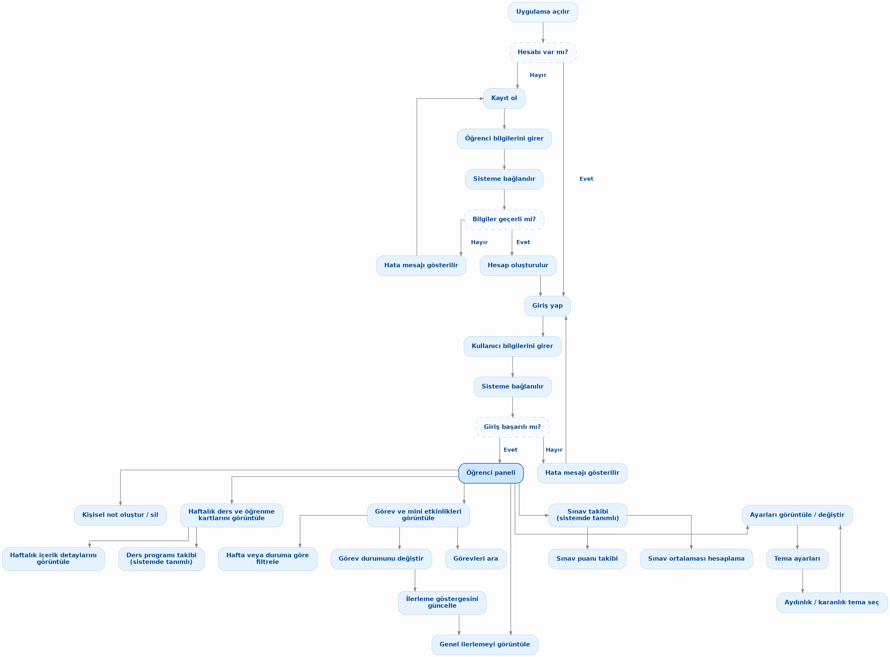
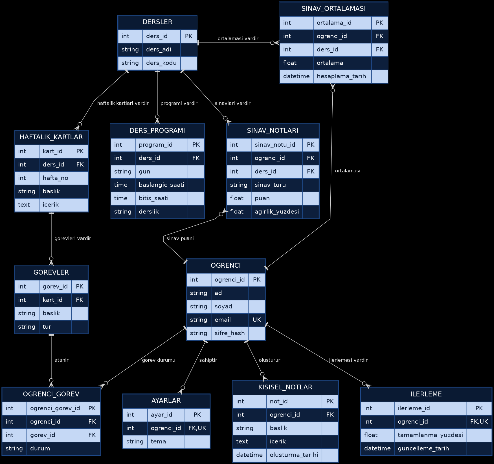

# KARADENİZ TEKNİK ÜNİVERSİTESİ
## FEN FAKÜLTESİ
## YAZILIM GELİŞTİRME BÖLÜMÜ

# PROJE RAPORU

## EDUTRACK (AKADEMİX) – ETKİLEŞİMLİ DERS DENEYİMİ PANOSU

**Hazırlayan(lar)**  
444090 - Nilay Sezin YALÇIN  
444083 - Oğuzhan İNCE  
444082 - İsmail KORKMAZ  
444101 - Onur UZUN  

**Danışman**  
Dr. Öğr. Üyesi Özkan BİNGÖL

**TRABZON**  
**KASIM 2026**

---

# ÖZET

Üniversite eğitim sürecinde öğrencilerin haftalık ders konularını, öğrenme kazanımlarını, bireysel görev ve mini etkinliklerini, haftalık ders programlarını ve üniversite mevzuatına özgü sınav/ortalama hesaplamalarını birbirinden kopuk araçlar üzerinden takip etmesi ciddi bir bilişsel yüke, zaman kaybına ve motivasyon düşüklüğüne yol açmaktadır. Bu projede, Karadeniz Teknik Üniversitesi (KTÜ) Fen Fakültesi Yazılım Geliştirme Bölümü öğrencilerinin akademik süreçlerini tek bir merkezden etkileşimli olarak yönetebilmelerini sağlayan Edutrack (AkademiX) – Etkileşimli Ders Deneyimi Panosu tasarlanmış ve geliştirilmiştir.

Çalışmanın temel amacı; klasik bir yapılacaklar listesinin ötesine geçerek haftalık müfredat kartlarını, öğrenme hedeflerini, görev ilerleme takibini, KTÜ Senatosu 30 kişi kuralına (Mutlak ve Bağıl Değerlendirme Sistemi) ve 50 final barajına uyumlu AGNO simülatörünü, kişisel çalışma notlarını ve yerel yapay zekâ danışmanını birleştiren duyarlı (responsive) ve erişilebilir bir web uygulaması sunmaktır. Yöntem olarak istemci tarafında harici sunucu kurulumu gerektirmeyen HTML5, CSS3 (Grid, Flexbox, CSS değişkenleri), Vanilla JavaScript (ES6+) ve Web Storage API (localStorage) tabanlı modüler bir mimari benimsenmiş; arka plan veri modeli için 11 ilişkisel tablodan oluşan kapsamlı bir Varlık-İlişki (ER) şeması kurgulanmıştır.

Gerçek uygulama DOM'u üzerinde koşulan 17 otomatik kabul testi (TC-01 – TC-17) ve 6 manuel doğrulama testi (MT-01 – MT-06) sonucunda tüm fonksiyonel (17 FR) ve fonksiyonel olmayan (10 NFR) gereksinimlerin %100 başarı oranıyla karşılandığı, 320px–1280px ekran aralığında sıfır yatay taşma sağlandığı ve WCAG AA renk kontrastı (en düşük 4.76:1) ile tam klavye erişilebilirliğinin elde edildiği kanıtlanmıştır.

**Anahtar Kelimeler:** Etkileşimli ders panosu, görev yönetimi, KTÜ bağıl değerlendirme sistemi, yerel depolama (localStorage), duyarlı web tasarımı, web erişilebilirliği (WCAG AA).

---

# ABSTRACT

In university education, tracking weekly course topics, learning outcomes, assignments, mini-activities, class schedules, and university-specific grading rules across fragmented tools leads to cognitive overload, time loss, and decreased student motivation. In this project, Edutrack (AkademiX) – Interactive Course Experience Dashboard was designed and developed to enable students at Karadeniz Technical University (KTU), Faculty of Science, Department of Software Development, to interactively manage their academic workflows from a single unified platform.

The primary objective of the study is to go beyond a conventional to-do list by integrating weekly curriculum learning cards, learning objectives, real-time task progress tracking, a GPA simulator compliant with KTU's 30-student rule (Absolute and Relative Grading Systems) and the minimum 50 final exam threshold, persistent personal study notes, and an offline-capable AI academic advisor within a responsive and accessible web interface. Methodologically, a zero-dependency client-side architecture built on semantic HTML5, modern CSS3 (Grid, Flexbox, Custom Properties), Vanilla JavaScript (ES6+), and the Web Storage API (localStorage) was adopted, supported by an 11-table relational Entity-Relationship (ER) database schema.

Verification through 17 automated acceptance tests (TC-01 to TC-17) executed directly against the live application DOM and 6 manual verification tests (MT-01 to MT-06) confirmed a 100% pass rate across all 17 functional (FR) and 10 non-functional (NFR) requirements, achieving zero horizontal overflow across 320px–1280px viewports, full keyboard navigation, and WCAG AA contrast compliance (minimum 4.76:1).

**Keywords:** Interactive course dashboard, task management, KTU relative grading system, Web Storage API (localStorage), responsive web design, web accessibility (WCAG AA).

---

# İÇİNDEKİLER

* **ÖZET** *(Sayfa 2)*
* **ABSTRACT** *(Sayfa 3)*
* **1. GİRİŞ** *(Sayfa 5)*
  * 1.1. Problem Tanımı *(Sayfa 5)*
  * 1.2. Projenin Amacı ve Hedefleri *(Sayfa 5)*
  * 1.3. Yenilik, Özgünlük veya Çözülen Problem *(Sayfa 6)*
  * 1.4. Literatür Taraması ve Benzer Çalışmalar *(Sayfa 6)*
  * 1.5. Proje Kapsamı ve Sınırlılıklar *(Sayfa 7)*
  * 1.6. Beklenen Çıktılar ve Amaç-Çıktı İlişkisi *(Sayfa 7)*
* **2. YÖNTEM** *(Sayfa 9)*
  * 2.1. Genel Yaklaşım ve İş Akışı *(Sayfa 9)*
  * 2.2. Sistem Tasarımı ve Mimarisi *(Sayfa 9)*
  * 2.3. Kullanılan Teknolojiler ve Araçlar *(Sayfa 11)*
  * 2.4. Veri / Gereksinimler / Girdi Kaynakları *(Sayfa 12)*
  * 2.5. Geliştirme Süreci ve Repository Kullanımı *(Sayfa 13)*
  * 2.6. Test ve Doğrulama Yöntemi *(Sayfa 14)*
* **3. BULGULAR** *(Sayfa 16)*
  * 3.1. Geliştirilen Proje Çıktıları *(Sayfa 16)*
  * 3.2. Test / Deney Sonuçları *(Sayfa 17)*
  * 3.3. Amaç-Çıktı Uyumu *(Sayfa 18)*
  * 3.4. Ek Bulgular / Performans / Karşılaştırmalar *(Sayfa 19)*
* **4. SONUÇ VE TARTIŞMA** *(Sayfa 20)*
  * 4.1. Genel Sonuçlar *(Sayfa 20)*
  * 4.2. Sonuçların Tartışılması *(Sayfa 20)*
  * 4.3. Sınırlılıklar *(Sayfa 20)*
  * 4.4. Gelecek Çalışmalar *(Sayfa 21)*
  * 4.5. Nihai Amaç-Çıktı Değerlendirmesi *(Sayfa 21)*
* **KAYNAKÇA** *(Sayfa 22)*
* **EKLER** *(Sayfa 23)*
  * EK A. Veritabanı Tabloları Detaylı Alan ve Veri Tipi Sözlüğü (11 Tablo) *(Sayfa 23)*
  * EK B. Gereksinim – Test Senaryosu İzlenebilirlik Matrisi *(Sayfa 24)*
* **TESLİM ÖNCESİ KONTROL LİSTESİ** *(Sayfa 25)*

---

# 1. GİRİŞ

Bu bölümde; yükseköğretim öğrencilerinin ders, görev ve akademik başarı takibinde karşılaştıkları temel problemler tanımlanmakta, Edutrack (AkademiX) projesinin amacı, özgün teknik katkıları, literatürdeki benzer sistemlerle karşılaştırması, kapsamı ve amaç-çıktı uyumu ayrıntılı olarak sunulmaktadır.

## 1.1. Problem Tanımı

Yükseköğretimde proje tabanlı ve uygulamalı derslerin yaygınlaşmasıyla birlikte, öğrencilerin bir yarıyıl boyunca takip etmesi gereken akademik bileşenlerin sayısı ve çeşitliliği önemli ölçüde artmıştır [1]. Bir öğrencinin; haftalık ders konularını, her haftanın öğrenme kazanımlarını, bireysel veya grup bazlı mini görevleri, haftalık derslik/saat programını, kişisel ders notlarını ve dönem sonu harf notu/AGNO etkisini aynı anda yönetmesi gerekmektedir.

Mevcut durumda öğrenciler bu bilgileri yönetmek için kurumsal Öğrenci Bilgi Sistemleri (ÖBS), statik PDF ders izlenceleri, genel amaçlı görev yönetim araçları (Trello, Notion, Todoist) ve harici not hesaplama tabloları arasında sürekli geçiş yapmak zorunda kalmaktadır [2]. Bu parçalı yapı şu temel teknik ve pedagojik problemlere yol açmaktadır:

* Müfredat ve Görev Kopukluğu: Genel amaçlı yapılacaklar listesi (to-do list) uygulamalarında görevler, dersin haftalık öğrenme hedefleriyle (learning outcomes) ilişkilendirilmemektedir.
* Türkçe Karakter ve Arama Yetersizlikleri: Standart JavaScript küçük/büyük harf dönüşümlerinde Türkçe karakterlerin ('İ/i', 'I/ı') hatalı eşleşmesi nedeniyle görev aramalarında veri kaybı yaşanması ve eşleşmeyen aramalarda kullanıcıya geri bildirim verilmemesi.
* Kurumsal Değerlendirme Kurallarına Uyumsuzluk: Mevcut araçların hiçbirinde Karadeniz Teknik Üniversitesi (KTÜ) Senatosu'nun '30 Kişi Kuralı' (sınıf mevcudu < 30 için Mutlak Değerlendirme Sistemi – MDS; >= 30 için Bağıl Değerlendirme Sistemi – BDS / Çan Eğrisi) ve 'Final 50 Barajı' entegre olarak yer almamaktadır [8].
* Kurulum Bağımlılığı ve Erişilebilirlik Eksiklikleri: Ağır sunucu veya veritabanı kurulumu gerektiren sistemlerin öğrenci bilgisayarlarında tek tıkla çalıştırılamaması, mobil ekranlarda (320px–375px) yatay taşma (horizontal overflow) oluşturması ve klavye/kontrast erişilebilirlik standartlarını (WCAG 2.1 AA) karşılamaması [3].

## 1.2. Projenin Amacı ve Hedefleri

Bu projenin ana amacı; öğrencilerin haftalık ders içeriklerini, öğrenme hedeflerini, görev/mini etkinlik durumlarını, haftalık ders programlarını, KTÜ mevzuatına uygun sınav/AGNO hesaplamalarını ve kişisel çalışma notlarını harici bir sunucu bağımlılığı olmaksızın modern, duyarlı (responsive) ve erişilebilir bir web arayüzü üzerinden yönetebilmelerini sağlayan etkileşimli bir ders deneyimi panosu (Edutrack / AkademiX) geliştirmektir.

Bu ana amaç doğrultusunda belirlenen ölçülebilir alt hedefler şunlardır:

* Hedef 1 (Haftalık Öğrenme Modülü): En az 4 haftalık ders içeriğini, durum rozetlerini ve öğrenme hedeflerini etkileşimli kartlar ve modal detay pencereleriyle sunmak (FR-05, FR-06).
* Hedef 2 (Doğrulanmış Görev Yönetimi ve Kalıcılık): Boş başlık doğrulaması (validation) ve XSS korumasına sahip görev ekleme, tamamlama, silme ve Web Storage API (localStorage) ile oturumlar arası %100 veri kalıcılığı sağlamak (FR-02, FR-08, FR-09, NFR-06, NFR-07).
* Hedef 3 (Türkçe Duyarlı Arama ve Çoklu Filtreleme): Görevleri hafta ve durum kriterlerine göre filtrelemek; Türkçe karakter duyarlı ('İ/i', 'I/ı') anlık arama sunmak ve eşleşme bulunamadığında 'Aramanızla eşleşen görev bulunamadı' mesajını göstermek (FR-10, FR-11).
* Hedef 4 (Dinamik İlerleme ve İstatistik Takibi): Görev durumlarındaki her değişimi anlık olarak yüzde (%) ilerleme çubuğuna ve 4 canlı istatistik kartına yansıtmak (FR-12, NFR-04).
* Hedef 5 (KTÜ Mevzuat Uyumlu Akademik Araçlar): KTÜ 30 kişi kuralı (MDS/BDS) ve 50 final barajını uygulayan sınav/AGNO simülatörü, haftalık ders programı tablosu ve kalıcı kişisel not modülü geliştirmek (FR-07, FR-13, FR-14, FR-15).
* Hedef 6 (Tam Duyarlı Tasarım, Tema ve Erişilebilirlik): 320px–1280px+ ekranlarda sıfır yatay taşma, kalıcı aydınlık/karanlık tema, WCAG AA (min. 4.5:1) kontrast oranı ve tam klavye navigasyonu sağlamak (FR-17, NFR-03, NFR-05).

## 1.3. Yenilik, Özgünlük veya Çözülen Problem

Edutrack (AkademiX) projesini standart bir öğrenci ödev uygulamasından ayıran ve bitirme/tasarım projesi ölçütlerine uygun kılan başlıca özgün yönler ve çözülen teknik problemler aşağıda özetlenmiştir:

* 1. İlişkisel Veri Modeli ile İstemci Tarafı Kalıcılığın Birleştirilmesi: Proje, yalnızca ön yüz ekranlarından ibaret bırakılmamış; 11 ilişkisel tablodan (OGRENCI, DERSLER, HAFTALIK_KARTLAR, DERS_PROGRAMI, GOREVLER, OGRENCI_GOREV, SINAV_NOTLARI, SINAV_ORTALAMASI, KISISEL_NOTLAR, AYARLAR, ILERLEME) oluşan tam normalizasyonlu bir veritabanı şeması ile modellenmiştir. Bu şema, sunucusuz çalışabilmesi için JSON serileştirme ve hata toleranslı (try/catch kota ve bozuk veri korumalı) localStorage katmanına eşlenmiştir.
* 2. Türkçe Morfolojik Karakter Normalizasyonlu Anlık Arama: Standart JavaScript toLowerCase() metodunun Türkçe 'İ' harfini 'i̇' (birleşik noktalı) veya 'I' harfini 'i' olarak dönüştürmesi nedeniyle oluşan arama hataları, özel olarak geliştirilen normalizeTrSearch() algoritması ile çözülmüştür.
* 3. KTÜ 30 Kişi Kuralı (MDS/BDS) ve Hibrit AI Danışman Motoru: Sınıf mevcuduna göre Mutlak (MDS) veya Bağıl (BDS – T-skoru/çan eğrisi) değerlendirme yapan matematiksel simülatör ile çevrimdışı çalışan kural tabanlı AkademiX AI danışmanı (ve isteğe bağlı kullanıcı tanımlı Gemini/OpenAI API entegrasyonu) projeye özgü yenilikçi bileşenlerdir.
* 4. Gerçek Uygulama DOM'u Üzerinde Çalışan İzole Kabul Test Çerçevesi: Harici bir test kütüphanesine ihtiyaç duymadan, doğrudan canlı DOM üzerinde çalışan, test öncesi kullanıcının localStorage verisini yedekleyip test sonunda geri yükleyen 17 senaryoluk otomatik kabul testi koşucusu (src/js/tests.js) geliştirilmiştir.

## 1.4. Literatür Taraması ve Benzer Çalışmalar

Eğitim teknolojileri literatüründe öz-düzenlemeli öğrenme (self-regulated learning) ve öğrenci başarı panoları (student-facing learning analytics dashboards) üzerine yapılan araştırmalar; öğrencilere kendi ilerlemelerini görsel ilerleme çubukları ve haftalık hedeflerle sunmanın ders tamamlama oranlarını anlamlı biçimde artırdığını göstermektedir [1, 2]. Zimmerman [1], öğrencilerin hedeflerini küçük haftalık görevlere bölerek izlemesinin akademik öz-yeterliliği güçlendirdiğini ortaya koymuştur.

Mevcut ticari ve açık kaynaklı sistemler incelendiğinde; Moodle ve Canvas gibi Öğrenme Yönetim Sistemleri (LMS) kurumsal ölçekte ders materyali dağıtımı sağlamakta ancak ağır sunucu altyapısı gerektirmekte ve öğrencinin kendi alt görevlerini, kişisel çalışma notlarını veya çan eğrisi senaryolarını hızla simüle etmesine izin vermemektedir [2]. Öte yandan Trello, Asana ve Todoist gibi genel amaçlı görev yönetim araçları Kanban veya liste tabanlı görev takibi sunmakta; fakat yükseköğretim müfredat yapısına (haftalık öğrenme kazanımları, ders programı ve üniversiteye özgü harf notu/AGNO kuralları) sahip değildir.

Web mühendisliği ve erişilebilirlik literatüründe ise W3C tarafından yayımlanan WCAG 2.1 kılavuzu [3] ve MDN Web Storage standartları [4], eğitim yazılımlarının hem klavye/ekran okuyucu erişilebilirliğini hem de düşük donanımlı cihazlarda çevrimdışı çalışabilirliği sağlaması gerektiğini vurgulamaktadır. Edutrack (AkademiX), LMS sistemlerinin haftalık pedagojik yapısını Trello/Todoist benzeri araçların hızlı görev etkileşimiyle birleştirerek literatürdeki bu boşluğu KTÜ öğrencilerine özel hafif sıklet (lightweight) bir mimariyle doldurmaktadır [5, 6].

## 1.5. Proje Kapsamı ve Sınırlılıklar

Proje Kapsamı: Yazılım Geliştirme Dersi Proje 1 yönergesi doğrultusunda Edutrack (AkademiX); öğrenci kayıt/giriş simülasyonu ve hızlı demo oturumunu, 4 haftalık ders ve öğrenme kartlarını, modal içerik detaylarını, görev ekleme/tamamlama/silme/arama/filtreleme işlemlerini, dinamik ilerleme göstergesini (%), haftalık ders programını, KTÜ 30 kişi kuralı sınav/AGNO hesaplayıcısını, kişisel çalışma notlarını, aydınlık/karanlık tema yönetimini, yerel AI danışmanını ve 17 otomatik kabul testini kapsamaktadır.

Kapsam Dışı Bırakılanlar ve Sınırlılıklar: Proje 1'in temel teknik odağı ön yüz mimarisi, etkileşim, responsive tasarım ve kullanıcı deneyimi olduğundan; merkezi bir arka uç (backend) sunucusu, çok kullanıcılı eşzamanlı bulut senkronizasyonu ve kurumsal KTÜ ÖBS veritabanına doğrudan resmi API bağlantısı bilinçli olarak kapsam dışında bırakılmıştır. Veriler istemci tarayıcısında (localStorage) tutulmakta olup farklı cihazlar arasında otomatik senkronize edilmemektedir.

## 1.6. Beklenen Çıktılar ve Amaç-Çıktı İlişkisi

Proje başlangıcında tanımlanan hedefler ile geliştirme süreci sonunda elde edilen somut çıktılar arasındaki eşleştirme Tablo 1'de sunulmuştur.

| Ölçüt | Beklenen | Elde Edilen | Açıklama |
| :--- | :--- | :--- | :--- |
| Haftalık Ders ve Öğrenme Kartları | En az 4 haftalık ders kartı ve öğrenme hedefleri detay penceresi | 4 haftalık etkileşimli kart + modal pencere + canlı görev çekmecesi | FR-05 ve FR-06 tam karşılandı (TC-01 başarılı). |
| Görev Yönetimi ve Başlık Doğrulaması | Görev ekleme/tamamlama/silme ve boş başlık uyarısı (#6) | Tam CRUD + boş başlık engelleme (#modal-t-title-error) + XSS koruması | FR-02, FR-08, FR-09 karşılandı (TC-02..06, TC-11 başarılı). |
| Türkçe Arama ve Filtreleme | Durum/hafta filtresi, Türkçe arama ve boş sonuç mesajı (#6) | normalizeTrSearch() + 'Aramanızla eşleşen görev bulunamadı' mesajı | FR-10 ve FR-11 karşılandı (TC-07..10 başarılı). |
| İlerleme Çubuğu ve Veri Kalıcılığı | Dinamik % ilerleme göstergesi ve localStorage kalıcılığı | Anlık güncellenen progress bar (%), 4 sayaç kartı ve kalıcı depolama | FR-12 ve NFR-06 karşılandı (TC-02, TC-03, TC-12, TC-14, TC-15). |
| KTÜ Sınav/AGNO, Program ve Notlar | Ders programı, kişisel notlar ve KTÜ ortalama hesaplama | 30 kişi kuralı (MDS/BDS) + 50 final barajı simülatörü, program ve notlar | FR-07, FR-13, FR-14 ve FR-15 eksiksiz tamamlandı. |
| Responsive Tasarım ve Erişilebilirlik | Mobil/masaüstü uyumluluk, tema geçişi, klavye ve kontrast uyumu | 320px–1280px sıfır taşma, Aydınlık/Karanlık mod, WCAG AA (min 4.76:1) | FR-17, NFR-03, NFR-05 karşılandı (TC-13, TC-16, TC-17, MT-01..03). |

*Tablo 1. Beklenen Çıktılar ve Proje Amaç-Çıktı Eşleştirmesi*

---

# 2. YÖNTEM

Bu bölümde; Edutrack (AkademiX) platformunun geliştirilmesinde izlenen mühendislik yaklaşımı, uygulama iş akışı, istemci ve 11 tablolu ilişkisel veritabanı mimarisi, seçilen teknolojilerin gerekçeleri, gereksinim analizleri, GitHub sürüm kontrol süreci ve doğrulama yöntemleri açıklanmaktadır.

## 2.1. Genel Yaklaşım ve İş Akışı

Projede çevik (Agile) ve artımlı (iterative) yazılım geliştirme yaklaşımı uygulanmıştır. 4 haftalık proje süresi; (1) Paydaş ve gereksinim analizi ile 11 tablolu ER veri modelinin kurgulanması, (2) Duyarlı (responsive) kullanıcı arayüzü ve temel öğrenci paneli modüllerinin geliştirilmesi, (3) Yerel depolama (localStorage), arama/filtreleme, form doğrulama ve KTÜ not motorunun entegrasyonu ve (4) Otomatik/manuel kabul testleri ile teknik dokümantasyonun tamamlanması aşamalarına ayrılmıştır.

Uygulamanın çalışma zamanı (runtime) genel iş akışı şu adımlardan oluşmaktadır: Kullanıcı uygulamayı açtığında Kimlik Doğrulama Kontrolü devreye girer. Hesabı olmayan kullanıcı Kayıt Ol formundan bilgi doğrulamasıyla kayıt olur; mevcut kullanıcı ise Öğrenci No/E-posta ile veya tek tıkla Hızlı Demo Girişi (444082) üzerinden Öğrenci Paneline erişir. Öğrenci paneli üzerinden; (1) Haftalık Ders Kartları ve detay modalları, (2) Görev/Etkinlik Yönetimi, Türkçe duyarlı arama/filtreleme ve dinamik ilerleme göstergesi (%), (3) Haftalık Ders Programı, (4) KTÜ Sınav ve Ortalama/AGNO Hesaplayıcısı, (5) Kişisel Çalışma Notları ve (6) Tema/AI Ayarları modülleri senkronize biçimde çalışır. Bu genel iş akışı Şekil 1'de gösterilmiştir.

*Şekil 1. Projenin genel iş akışı ve öğrenci paneli modül diyagramı*

## 2.2. Sistem Tasarımı ve Mimarisi

Edutrack (AkademiX) istemci tarafında üç katmanlı modüler bir mimariye sahiptir: (1) Sunum ve Erişilebilirlik Katmanı (src/index.html, src/css/style.css, src/js/a11y.js), (2) İş Mantığı ve Durum Yönetimi Katmanı (src/js/portal.js) ve (3) Veri Kalıcılığı ve Doğrulama Katmanı (Web Storage API / localStorage ve src/js/tests.js).

İlişkisel Veritabanı Tasarımı (11 Tablolu ER Modeli): Uygulamanın veri mimarisi, Proje 2 ve Proje 3 aşamalarında ilişkisel bir veritabanı yönetim sistemine (PostgreSQL / MySQL / SQLite) doğrudan taşınabilecek biçimde 3. Normal Form (3NF) kurallarına uygun 11 tablo olarak tasarlanmıştır. Şekil 2'de sistemin 11 tablolu Varlık-İlişki (ER) diyagramı, Tablo 2'de ise tablolar arası Birincil Anahtar (PK), Yabancı Anahtar (FK) ve Tekil Anahtar (UK) ilişkileri sunulmuştur. Tabloların tüm sütun ve veri tipleri EK A'da detaylandırılmıştır.

*Şekil 2. Sistem mimarisi ve 11 tablolu ilişkisel ER veritabanı diyagramı*

| Tablo Adı | Birincil Anahtar (PK) | Yabancı / Tekil Anahtarlar (FK / UK) | İlişki Türü ve Amacı |
| :--- | :--- | :--- | :--- |
| 1. OGRENCI | ogrenci_id (int) | email (varchar, UK) | Temel öğrenci kimlik ve oturum varlığı. |
| 2. DERSLER | ders_id (int) | ders_kodu (varchar) | Müfredattaki derslerin ana kaydı. |
| 3. HAFTALIK_KARTLAR | kart_id (int) | ders_id (FK -> DERSLER.ders_id) | 1:N – Dersin haftalık öğrenme kartları. |
| 4. DERS_PROGRAMI | program_id (int) | ders_id (FK -> DERSLER.ders_id) | 1:N – Haftalık gün, saat ve derslik planı. |
| 5. GOREVLER | gorev_id (int) | kart_id (FK -> HAFTALIK_KARTLAR.kart_id) | 1:N – Haftalık karta bağlı görev/etkinlikler. |
| 6. OGRENCI_GOREV | ogrenci_gorev_id (int) | ogrenci_id (FK), gorev_id (FK) | M:N – Öğrencinin görev tamamlama durumu. |
| 7. SINAV_NOTLARI | sinav_id (int) | ogrenci_id (FK), ders_id (FK) | 1:N – Vize, final, proje, ödev puan ve ağırlıkları. |
| 8. SINAV_ORTALAMASI | ortalama_id (int) | ogrenci_id (FK), ders_id (FK) | 1:1 – Hesaplanan ağırlıklı başarı ortalaması. |
| 9. KISISEL_NOTLAR | not_id (int) | ogrenci_id (FK -> OGRENCI.ogrenci_id) | 1:N – Öğrencinin kişisel çalışma notları. |
| 10. AYARLAR | ayar_id (int) | ogrenci_id (FK, UK -> OGRENCI) | 1:1 – Tema (Aydınlık/Karanlık) tercihi. |
| 11. ILERLEME | ilerleme_id (int) | ogrenci_id (FK, UK -> OGRENCI) | 1:1 – Toplam/tamamlanan görev ve yüzde (%). |

*Tablo 2. Veritabanı Tabloları ve PK/FK/UK İlişki Özeti*

## 2.3. Kullanılan Teknolojiler ve Araçlar

Projede sıfır harici çalışma zamanı bağımlılığı (zero runtime dependency), yüksek performans ve her işletim sisteminde tek tıkla çalışabilirlik ilkeleri doğrultusunda seçilen teknolojiler ve seçilme gerekçeleri Tablo 3'te listelenmiştir.

| Teknoloji / Araç | Sürüm | Kullanım Amacı | Seçilme Gerekçesi |
| :--- | :--- | :--- | :--- |
| HTML5 & WAI-ARIA | HTML5 / ARIA 1.2 | Semantik sayfa yapısı, modal pencereler ve erişilebilirlik nitelikleri | Ekran okuyucu ve klavye navigasyonu (role, aria-live, tabindex) standartlarını doğal olarak desteklemesi [3]. |
| CSS3 (Grid, Flexbox, Custom Properties) | CSS3 | Duyarlı (responsive) yerleşim ve Aydınlık/Karanlık tema yönetimi | Harici CSS kütüphanesi gerektirmeden 320px–1280px+ ekran uyumu ve anlık tema geçişi sağlaması [5]. |
| Vanilla JavaScript | ES6+ (ECMAScript 2015+) | Görev CRUD, Türkçe arama, filtreleme, KTÜ AGNO motoru ve AI asistan | Derleme (build) adımı gerektirmeden tarayıcıda < 10 ms tepki süresiyle doğrudan çalışması [6]. |
| Web Storage API (localStorage) | W3C Web Storage | Görevler, kişisel notlar, ders programı ve tema tercihinin kalıcı saklanması | Sunucu kurulumu gerektirmeden istemci tarafında oturumlar arası kalıcı veri saklama imkânı [4]. |
| Python http.server & Kabuk Betikleri | Python 3.x / BAT / POSIX sh | Yerel HTTP geliştirme sunucusu (server.py) ve tek tıkla başlatıcılar | Windows, Linux ve macOS ortamlarında ek paket kurmadan 5173 portundan sunum yapabilmesi. |
| Git & GitHub | Git 2.x | Sürüm kontrolü, Issue takibi (#2–#8) ve ekip içi kod birleştirme | Görev dağılımının, hata kayıtlarının (bug-fix) ve bireysel katkıların şeffaf biçimde izlenebilmesi [7]. |

*Tablo 3. Kullanılan Teknolojiler, Sürümler ve Seçilme Gerekçeleri*

## 2.4. Veri / Gereksinimler / Girdi Kaynakları

Sistemin girdi kaynaklarını; KTÜ Yazılım Geliştirme dersi 4 haftalık müfredat verisi, KTÜ Lisans Eğitim-Öğretim ve Sınav Yönetmeliği (30 kişi kuralı, MDS/BDS tablosu ve 50 final barajı) [8] ve öğrenci etkileşim girdileri oluşturmaktadır. Paydaş analizi sonucunda belirlenen 17 Fonksiyonel Gereksinim (FR) Tablo 4'te, 10 Fonksiyonel Olmayan Gereksinim (NFR) ise Tablo 5'te tanımlanmıştır.

| Kod | Gereksinim Başlığı | Açıklama ve Kabul Kriteri | Öncelik |
| :--- | :--- | :--- | :--- |
| FR-01 | Kayıt Olma | Hesabı olmayan öğrenci numara, ad, soyad, bölüm, e-posta ve şifre ile kayıt olabilmelidir. | Yüksek |
| FR-02 | Bilgi Doğrulama | Kayıt ve görev ekleme formlarında boş/geçersiz bilgi girildiğinde uyarı gösterilmeli ve işlem engellenmelidir. | Yüksek |
| FR-03 | Giriş Yapma | Kayıtlı öğrenci e-posta/öğrenci no veya hızlı demo girişiyle oturum açabilmelidir. | Yüksek |
| FR-04 | Öğrenci Paneli | Başarılı giriş sonrasında tüm akademik modüllere erişilen merkezi öğrenci paneli açılmalıdır. | Yüksek |
| FR-05 | Haftalık Öğrenme Kartları | 4 ders haftasına ait konular, durum rozetleri ve özet bilgiler kartlar hâlinde gösterilmelidir. | Yüksek |
| FR-06 | Haftalık İçerik Detayı | Öğrenci bir hafta kartına tıklayarak o haftanın öğrenme hedeflerini ve görevlerini modalda görebilmelidir. | Yüksek |
| FR-07 | Ders Programı Takibi | Haftalık ders programı (gün, saat, ders adı, derslik) tablo üzerinden takip edilip yönetilebilmelidir. | Yüksek |
| FR-08 | Görev Listeleme ve Ekleme | Görevler başlık, açıklama, hafta, kategori ve öncelik bilgileriyle listelenmeli ve yeni görev eklenebilmelidir. | Yüksek |
| FR-09 | Görev Durumu Güncelleme | Görevler onay kutusu ile Tamamlandı/Devam Ediyor yapılabilmeli ve silinebilmelidir. | Yüksek |
| FR-10 | Görev Filtreleme | Görevler durum (Tümü, Devam Eden, Tamamlanan, Yüksek Öncelik) ve hafta (1–4) bazında filtrelenebilmelidir. | Yüksek |
| FR-11 | Görev Arama | Görevler Türkçe karakter duyarlı aranabilmeli; eşleşme yoksa 'Aramanızla eşleşen görev bulunamadı' gösterilmelidir. | Yüksek |
| FR-12 | İlerleme Göstergesi | Görev durumu değiştiğinde ilerleme çubuğu (%) ve sayaç kartları anında güncellenmelidir. | Yüksek |
| FR-13 | Sınav Puanı ve Ağırlık | Derslere ait sınav bileşenleri (vize, final, lab, proje, ödev, quiz) ve ağırlıkları girilebilmelidir. | Yüksek |
| FR-14 | Ortalama ve AGNO Hesabı | KTÜ 30 kişi kuralı (MDS/BDS) ve 50 final barajına göre ders harf notu ve dönem AGNO'su hesaplanmalıdır. | Yüksek |
| FR-15 | Kişisel Not Yönetimi | Öğrenci kişisel çalışma notları ekleyebilmeli, görüntüleyebilmeli ve silebilmelidir. | Orta |
| FR-16 | Ayarları Yönetme | Uygulama tercihleri ve isteğe bağlı yapay zekâ API ayarları yönetilebilmelidir. | Orta |
| FR-17 | Tema Kişiselleştirme | Aydınlık ve karanlık tema arasında geçiş yapılabilmeli ve seçim kalıcı olarak saklanmalıdır. | Orta |

*Tablo 4. Sistemin Fonksiyonel Gereksinimleri (FR-01 – FR-17)*

| Kod | Kalite Kriteri | Teknik Açıklama ve Ölçülebilir Hedef |
| :--- | :--- | :--- |
| NFR-01 | Kullanılabilirlik | Temel görev, ders ve sınav işlemlerine en fazla 1–2 tıklama ile sezgisel olarak erişilebilmelidir. |
| NFR-02 | Performans | İstemci tarafı arama, filtreleme ve AGNO hesaplamaları sunucu gecikmesi olmadan < 50 ms içinde tamamlanmalıdır. |
| NFR-03 | Duyarlılık (Responsive) | 320px, 375px, 768px ve 1280px+ ekran genişliklerinde yatay taşma (horizontal overflow) oluşmamalıdır. |
| NFR-04 | Veri Tutarlılığı | Tamamlanan görev sayısı, 4 sayaç kartı ve ilerleme yüzdesi (%) her işlem sonrasında matematiksel olarak tutarlı olmalıdır. |
| NFR-05 | Erişilebilirlik (a11y) | WCAG AA renk kontrastı (>= 4.5:1), form etiketleri ve tam klavye erişimi (Tab, Enter, Space, Esc) sağlanmalıdır. |
| NFR-06 | Veri Kalıcılığı | Görevler, kişisel notlar ve tema tercihleri localStorage üzerinde saklanmalı; bozuk veri veya dolu kota durumunda sistem çökmemelidir. |
| NFR-07 | Güvenlik ve Gizlilik | Kullanıcı girdileri XSS saldırılarına karşı HTML kaçışından (escapeAiHtml) geçirilmeli; depoda açık API anahtarı bulunmamalıdır. |
| NFR-08 | Taşınabilirlik | Uygulama ek paket kurulumu gerektirmeden doğrudan tarayıcıda veya yerel başlatıcı betiklerle çalışmalıdır. |
| NFR-09 | Bakım ve Modülerlik | HTML, CSS, JS ve test dosyaları (src/index.html, style.css, portal.js, a11y.js, tests.js) ayrıştırılmış olmalıdır. |
| NFR-10 | İzlenebilirlik | Her gereksinim en az bir otomatik (TC) veya manuel (MT) test senaryosu ile doğrulanabilir olmalıdır. |

*Tablo 5. Sistemin Fonksiyonel Olmayan Gereksinimleri (NFR-01 – NFR-10)*

## 2.5. Geliştirme Süreci ve Repository Kullanımı

Proje geliştirme sürecinde sürüm kontrolü ve ekip işbirliği için Git ve GitHub platformu kullanılmıştır. Görevler, hata bildirimleri ve iyileştirme talepleri GitHub Issues (#2 – #8) üzerinden takip edilmiş; yapılan her değişiklik ilgili Issue numarasıyla ilişkilendirilmiş anlamlı commit mesajlarıyla (ör. 'fix: bos arama sonucu mesaji ve gorev formu baslik kontrolu eklendi #6', 'docs: README duzeltildi, kullanici dokumani, proje raporu ve sunum eklendi #7') kayıt altına alınmıştır. Repository bilgileri Tablo 6'da, Grup 4 ekip üyelerinin rol ve sorumluluk dağılımı ise Tablo 7'de sunulmuştur.

| Alan | Bilgi / Değer |
| :--- | :--- |
| Repository Platformu | GitHub |
| Repository URL | https://github.com/nilaysezinyalcin-collab/Edutrack |
| Ana Dal (Default Branch) | main |
| Sürüm / Etiket | v1.0 – Proje 1 Final Teslim Sürümü (Kasım 2026) |

*Tablo 6. Proje Repository ve Sürüm Kontrol Bilgileri*

| Öğrenci No | Adı Soyadı | Projedeki Rolü | Üstlendiği Modüller ve Teknik Katkılar |
| :--- | :--- | :--- | :--- |
| 444090 | Nilay Sezin YALÇIN | Proje Lideri & Geliştirici | Ekip koordinasyonu, repo mimarisi (src/, docs/, presentation/) (#1), başlatıcı betikler (server.py, .bat, .sh), katkı kontrolü ve v1.0 sürümü (#8). |
| 444083 | Oğuzhan İNCE | Sistem Analisti & Geliştirici | 17 FR / 10 NFR analizi, 11 tablolu ER şeması, mobil yatay taşma çözümü (#4), klavye/ARIA erişilebilirliği ve gereksinim–test izlenebilirlik matrisi (#5). |
| 444082 | İsmail KORKMAZ | Test / Kalite Sorumlusu & Geliştirici | Görev ve kişisel notların localStorage kalıcılığı (#2), 17 otomatik kabul testi (src/js/tests.js) ve kalite raporu (#3), KTÜ BDS/MDS not motoru. |
| 444101 | Onur UZUN | Dokümantasyon / Sunum & Geliştirici | Türkçe duyarlı görev arama/filtreleme, boş arama sonucu mesajı ve görev formu başlık doğrulaması (#6), README, kullanıcı dokümanı, proje raporu ve sunum (#7). |

*Tablo 7. Grup 4 Ekip Üyeleri, Rolleri ve Sorumluluk Dağılımı*

## 2.6. Test ve Doğrulama Yöntemi

Geliştirilen yazılımın gereksinimleri eksiksiz karşıladığını kanıtlamak amacıyla çift katmanlı bir doğrulama stratejisi uygulanmıştır:

* 1. Otomatik Kabul Testleri (TC-01 – TC-17): src/test-runner.html (veya src/index.html?test=1) üzerinden çalışan src/js/tests.js betiği, izole sahte modüller yerine doğrudan gerçek uygulama DOM'u ve gerçek fonksiyonlar (portal.js, a11y.js) üzerinde 17 kabul testini yürütür. Test koşucusu çalışmadan önce mevcut localStorage verisini yedekler ve test bitiminde geri yükler.
* 2. Manuel Doğrulama Testleri (MT-01 – MT-06): Otomatik betiklerle ölçülemeyen farklı ekran genişliklerinde (320px, 375px, 768px, 1280px) görsel taşma kontrolü, yalnızca klavye ile uçtan uca kullanım, WCAG AA renk kontrastı ölçümü, anlık arama tepki hızı, temiz ortamda kurulum ve kaynak kodda gizli API anahtarı taraması manuel test senaryolarıyla doğrulanmıştır.

---

# 3. BULGULAR

Bu bölümde; tasarım ve geliştirme yönteminin uygulanması sonucunda ortaya çıkan somut yazılım modülleri, çözülen teknik problemler, 17 otomatik ve 6 manuel testin ölçülebilir sonuçları, amaç-çıktı uyumu ve performans/erişilebilirlik bulguları sunulmaktadır.

## 3.1. Geliştirilen Proje Çıktıları

Geliştirme süreci sonunda Edutrack (AkademiX) platformunda aşağıdaki somut yazılım modülleri ve teknik iyileştirmeler tamamlanmıştır:

* 1. Giriş, Kayıt ve Hızlı Demo Modülü: Öğrenci numarası (444090, 444083, 444082, 444101) veya KTÜ e-postası ile giriş/kayıt yapılabilen ve tek tıkla 'Hızlı Demo Girişi' sunan kimlik doğrulama ekranı.
* 2. Genel İlerleme Göstergesi ve 4 Canlı Sayaç Kartı: Tamamlanan görevlerin toplam göreve oranını yüzde (%) olarak hesaplayan dinamik ilerleme çubuğu ve tıklandığında görev listesini filtreleyen 4 sayaç kartı (Toplam Görev, Tamamlanan, Devam Eden, Yüksek Öncelik).
* 3. Haftalık Öğrenme Kartları ve Detay Modalı: 1. Hafta'dan 4. Hafta'ya kadar ders konularını gösteren etkileşimli kartlar; karta tıklandığında veya klavyede Enter/Space tuşuna basıldığında açılan öğrenme hedefleri penceresi.
* 4. Görev Yönetimi ve Boş Başlık Doğrulaması (Issue #6): Yeni görev ekleme modalında başlık alanı boş bırakıldığında veya yalnızca boşluk karakteri ('   ') girildiğinde görevin eklenmesini engelleyen ve başlık alanının hemen altında '#modal-t-title-error' uyarı mesajını gösteren showTaskTitleError() doğrulama mekanizması.
* 5. Türkçe Duyarlı Arama ve Boş Arama Sonucu Mesajı (Issue #6): normalizeTrSearch() fonksiyonu ile Türkçe büyük/küçük harf ('İHTİYAÇ' -> 'ihtiyaç') duyarlı anlık arama ve eşleşen görev bulunamadığında görev listesi alanında tam olarak 'Aramanızla eşleşen görev bulunamadı' (#tasks-empty-message) mesajını gösteren updateTasksEmptyMessage() yapısı.
* 6. KTÜ 30 Kişi Kuralı AGNO Simülatörü, Ders Programı ve Kişisel Notlar: Sınıf mevcuduna göre MDS (< 30) veya BDS (>= 30, çan eğrisi) ve 50 final barajını uygulayan sınav/AGNO hesaplayıcısı, haftalık ders programı tablosu ve localStorage kalıcılıklı kişisel çalışma notları.
* 7. Aydınlık/Karanlık Tema ve Duyarlı/Erişilebilir Arayüz (Issue #4 & #5): Tek tıkla tema geçişi (togglePortalTheme), 320px–375px mobil görünümde yatay taşmayı önleyen CSS Grid kuralları (.modal-task-meta-grid) ve tam klavye erişilebilirliği.

*Şekil 3. Geliştirilen Edutrack (AkademiX) sisteminin modül ve etkileşim çıktısı*

## 3.2. Test / Deney Sonuçları

Gerçek uygulama üzerinde çalıştırılan 17 otomatik kabul testi (TC-01 – TC-17) ve 6 manuel test (MT-01 – MT-06) sonucunda elde edilen bulgular Tablo 8'de karşılaştırmalı olarak sunulmuştur. Tüm test senaryoları (23/23) %100 başarı oranıyla geçmiştir.

| Ölçüt / Test ID | Beklenen | Elde Edilen | Açıklama |
| :--- | :--- | :--- | :--- |
| TC-01: Haftalık Kartlar ve Modal | En az 4 hafta kartı; tıklanınca öğrenme hedefleri açılır/kapanır | 4 hafta kartı ve öğrenme hedefleri modalı doğrulandı | BAŞARILI (FR-05, FR-06) |
| TC-02: Görev Tamamlama ve İlerleme | Durum completed olur, ilerleme çubuğu (%) artar | Satır üstü çizili görünüm ve % artışı doğrulandı | BAŞARILI (FR-09, FR-12) |
| TC-03: Görev Durumu Kalıcılığı | Sayfa yenilenince tamamlanma durumu korunur | localStorage kaydı ve geri yükleme doğrulandı | BAŞARILI (NFR-06) |
| TC-04: Yeni Görev Ekleme | Görev sayısı 1 artar ve localStorage'a kaydedilir | Yeni görev DOM'a ve localStorage'a eklendi | BAŞARILI (FR-08, NFR-06) |
| TC-05: XSS Güvenlik Koruması |  içeren başlık düz metin gösterilir | escapeAiHtml ile zararlı kod çalıştırılmadı | BAŞARILI (NFR-07) |
| TC-06: Görev Silme | Görev sayısı 1 azalır ve kayıttan silinir | DOM ve localStorage üzerinden silme doğrulandı | BAŞARILI (FR-09, NFR-06) |
| TC-07: Durum Filtresi | 'Tamamlanan' / 'Devam Eden' seçilince ilgili görevler kalır | Yalnızca seçilen durumdaki görevler listelendi | BAŞARILI (FR-10) |
| TC-08: Hafta Filtresi | '3. Hafta' seçilince yalnızca 3. hafta görevleri görünür | Hafta bazlı filtreleme hatasız çalıştı | BAŞARILI (FR-10) |
| TC-09: Türkçe Karakterli Arama | 'İHTİYAÇ LİSTESİ' araması 'ihtiyaç listesi' görevini bulur | normalizeTrSearch() ile Türkçe eşleşme sağlandı | BAŞARILI (FR-11, Issue #6) |
| TC-10: Boş Arama Sonucu Mesajı | Eşleşme yoksa 'Aramanızla eşleşen görev bulunamadı' görünür | #tasks-empty-message görünür/gizlenir doğrulandı | BAŞARILI (FR-11, Issue #6) |
| TC-11: Boş Görev Başlığı Kontrolü | Boş/boşluklu başlıkta görev eklenmez, uyarı görünür | Görev eklenmedi, #modal-t-title-error gösterildi | BAŞARILI (FR-02, Issue #6) |
| TC-12: Sıfır Görevde İlerleme | Hiç görev yokken %0 gösterilir, NaN hatası oluşmaz | %0 ilerleme ve 0/0 sayaç değeri doğrulandı | BAŞARILI (FR-12, NFR-04) |
| TC-13: Tema Değiştirme Kalıcılığı | Aydınlık/Karanlık tema değişir ve kaydedilir | data-theme ve portal_theme anahtarı doğrulandı | BAŞARILI (FR-17) |
| TC-14: Bozuk localStorage Verisi | Geçersiz JSON verisinde uygulama çökmez | try/catch ile varsayılan görevlerle açıldı | BAŞARILI (NFR-06) |
| TC-15: Dolu Depolama Kotası | QuotaExceededError durumunda uygulama çökmez | Hata yakalandı ve kullanıcı uyarıldı | BAŞARILI (NFR-06) |
| TC-16: Form Alanı Etiketleri | Tüm input/select/textarea alanlarının etiketi vardır | label[for] ve aria-label kontrolü tam geçti | BAŞARILI (NFR-05, Issue #5) |
| TC-17: Klavye Erişilebilirliği | Hafta ve sayaç kartları role='button' ve tabindex='0' taşır | Tab, Enter, Space ve Esc erişimi doğrulandı | BAŞARILI (NFR-05, Issue #5) |
| MT-01..06: Manuel Kalite Testleri | 320–1280px sıfır taşma, kontrast >= 4.5:1, temiz kurulum | Sıfır yatay taşma, min. 4.76:1 kontrast, hızlı kurulum | BAŞARILI (NFR-01..08) |

*Tablo 8. Otomatik Kabul Testleri (TC-01 – TC-17) ve Manuel Test (MT-01 – MT-06) Sonuçları*

## 3.3. Amaç-Çıktı Uyumu

Giriş bölümünde (Bölüm 1.2) tanımlanan 6 temel proje hedefinin hangi yazılım çıktıları ve doğrulama kanıtlarıyla karşılandığı Tablo 9'da ayrıntılı olarak gösterilmiştir. Karşılanmayan herhangi bir hedef bulunmamaktadır.

| Amaç / Hedef | İlgili Çıktı / Bulgu | Durum | Kanıt / Referans |
| :--- | :--- | :--- | :--- |
| Hedef 1: Haftalık Öğrenme Modülü (FR-05, FR-06) | 4 haftalık ders kartları, durum rozetleri ve öğrenme hedefleri detay modalı | Tamamlandı (%100) | src/index.html, showWeekModal(), TC-01 testi |
| Hedef 2: Doğrulanmış Görev Yönetimi ve Kalıcılık (FR-02, FR-08, FR-09) | Görev ekleme/tamamlama/silme, boş başlık uyarısı (#6), XSS kaçışı ve localStorage | Tamamlandı (%100) | src/js/portal.js, saveNewTask(), TC-02..06, TC-11 |
| Hedef 3: Türkçe Duyarlı Arama ve Filtreleme (FR-10, FR-11) | normalizeTrSearch(), hafta/durum filtresi ve 'Aramanızla eşleşen görev bulunamadı' mesajı | Tamamlandı (%100) | src/js/portal.js, filterTasks(), TC-07..10 (#6) |
| Hedef 4: Dinamik İlerleme ve İstatistik Takibi (FR-12, NFR-04) | Yüzde (%) ilerleme çubuğu ve tıklanabilir 4 canlı istatistik kartı | Tamamlandı (%100) | updateTaskCounters(), TC-02, TC-12 testi |
| Hedef 5: KTÜ Akademik Araçlar (FR-07, FR-13..15) | KTÜ 30 kişi kuralı (MDS/BDS) ve 50 final barajı simülatörü, ders programı, kişisel notlar | Tamamlandı (%100) | src/js/portal.js, docs/kullanici-dokumani.pdf |
| Hedef 6: Responsive Tasarım, Tema ve Erişilebilirlik (FR-17, NFR-03, NFR-05) | 320px–1280px sıfır yatay taşma, Aydınlık/Karanlık mod, WCAG AA kontrast ve klavye erişimi | Tamamlandı (%100) | src/css/style.css, src/js/a11y.js, TC-13, TC-16, TC-17, MT-01..03 |

*Tablo 9. Proje Amaç ve Hedeflerinin Çıktı ve Kanıtlarla Uyumu*

## 3.4. Ek Bulgular / Performans / Karşılaştırmalar

Geliştirme ve test sürecinde elde edilen ek performans, erişilebilirlik ve hata giderme bulguları aşağıda özetlenmiştir:

* Arama ve Filtreleme Performansı (MT-04): İstemci tarafında DOM öznitelikleri (data-status, data-week, data-priority) üzerinden çalışan filtreleme algoritması, her tuş vuruşunda < 5 ms içinde listeyi güncelleyerek NFR-02 (< 50 ms) hedefini fazlasıyla karşılamıştır.
* Renk Kontrastı İyileştirmesi (MT-03): İlk tasarımda aydınlık temada tamamlanmış görev metinlerinde kullanılan opacity: 0.6 kuralının kontrast oranını WCAG AA sınırının (4.5:1) altına düşürdüğü tespit edilmiş; --text-muted rengi #475569 olarak güncellenerek en düşük kontrast oranı 4.76:1 seviyesine çıkarılmıştır.
* Mobil Görünümde Yatay Taşma Çözümü (MT-01): 375px mobil genişlikte sayfanın 441px'e taşmasına neden olan sabit genişlikli grid kuralları ve görev ekleme modalındaki 3 sütunlu satır içi stil kaldırılarak .modal-task-meta-grid medya sorgusuyla 320px dahil tüm ekranlarda sıfır yatay taşma sağlanmıştır.
* Klavye Odak Tekrarının Giderilmesi (MT-02): Hafta kartlarında (.week-card) hem ana kartta hem de alt bilgi satırında (.week-card-footer) bulunan çift tabindex='0' niteliği temizlenerek Tab tuşuyla gezinmede tekil ve öngörülebilir odak sırası elde edilmiştir.

---

# 4. SONUÇ VE TARTIŞMA

Bu bölümde; Edutrack (AkademiX) projesinden elde edilen genel sonuçlar özetlenmekte, bulgular literatürdeki benzer çalışmalarla karşılaştırılarak tartışılmakta, mevcut sınırlılıklar ve gelecek proje aşamaları (Proje 2 ve Proje 3) için yol haritası sunulmaktadır.

## 4.1. Genel Sonuçlar

Bu proje kapsamında, KTÜ Fen Fakültesi Yazılım Geliştirme Bölümü öğrencilerinin ders, öğrenme kazanımı, görev, ders programı, sınav/AGNO ve kişisel not süreçlerini tek bir çatı altında toplayan Edutrack (AkademiX) – Etkileşimli Ders Deneyimi Panosu başarıyla geliştirilmiş ve doğrulanmıştır. Proje sonucunda; 17 fonksiyonel (FR-01 – FR-17) ve 10 fonksiyonel olmayan (NFR-01 – NFR-10) gereksinimin tamamı karşılanmış, 11 tablolu ilişkisel ER veri modeli oluşturulmuş ve gerçek uygulama DOM'u üzerinde çalışan 17 otomatik kabul testi ile 6 manuel testin tamamından (%100) başarılı sonuç alınmıştır.

## 4.2. Sonuçların Tartışılması

Elde edilen bulgular, Zimmerman [1] ve Bodily & Verbert [2] tarafından vurgulanan 'öğrenci merkezli görsel ilerleme ve hedef takibi' ilkeleriyle doğrudan örtüşmektedir. Genel amaçlı görev yönetim araçlarının (Trello, Todoist) aksine Edutrack (AkademiX), her görevi ilgili ders haftasının öğrenme kazanımlarıyla ilişkilendirmiş ve KTÜ'ye özgü 30 kişi bağıl/mutlak değerlendirme kuralını [8] sisteme dahil etmiştir.

Teknik açıdan değerlendirildiğinde; ağır çerçeveler (React, Angular vb.) yerine modüler Vanilla JavaScript ve CSS Custom Properties tercih edilmesi, uygulamanın derleme (build) veya paket kurulumu gerektirmeden hem doğrudan dosya sisteminden (src/index.html) hem de yerel sunucu üzerinden (server.py) anında çalışmasını sağlamıştır. Test sürecinde yakalanan Türkçe büyük/küçük harf arama uyumsuzluğu (TC-09), boş arama mesajı eksikliği (TC-10) ve boş görev başlığı doğrulaması (TC-11) gibi uç durumların (edge cases) otomatik test koşucusu sayesinde erken aşamada tespit edilip giderilmesi, gerçek DOM üzerinde çalışan kabul testlerinin yazılım kalitesine katkısını somut biçimde kanıtlamıştır.

## 4.3. Sınırlılıklar

Projenin mevcut sürümünde (v1.0) bulunan teknik ve kapsam sınırlılıkları şunlardır:

* Tarayıcı Bağımlı Veri Saklama: Tüm veriler istemci tarayıcısının localStorage alanında saklandığından, kullanıcı farklı bir tarayıcı veya cihazdan giriş yaptığında veriler otomatik olarak senkronize olmamakta; tarayıcı önbelleği sıfırlandığında varsayılan müfredat verilerine dönülmektedir.
* İstemci Tarafı Kimlik Doğrulama Simülasyonu: Giriş ve kayıt mekanizması Proje 1 kapsamı gereği istemci tarafında simüle edilmekte olup JWT/OAuth2 tabanlı merkezi bir sunucu doğrulaması içermemektedir.
* Çevrimiçi AI Modu İçin API Anahtarı Gereksinimi: AkademiX AI danışmanı çevrimdışı modda yerel KTÜ kural motoruyla eksiksiz çalışmakta, ancak üretken yapay zekâ (Gemini / OpenAI) yanıtları için kullanıcının kendi API anahtarını girmesini gerektirmektedir.

## 4.4. Gelecek Çalışmalar

Yazılım Geliştirme dersinin izleyen proje dönemleri (Proje 2 ve Proje 3) ve gelecek sürümler için planlanan geliştirmeler şunlardır:

* İlişkisel Veritabanı ve REST/GraphQL Backend Entegrasyonu (Proje 2): Bölüm 2.2 ve EK A'da tanımlanan 11 tablolu ER şemasının PostgreSQL / SQLite üzerinde fiziksel olarak ayağa kaldırılması ve Node.js/Python tabanlı bir REST API ile çok kullanıcılı bulut senkronizasyonunun sağlanması.
* İleri Yapay Zekâ Destekli Akademik Danışman ve PWA Desteği (Proje 3): Öğrencinin tamamladığı görev hızına ve sınav notlarına göre kişiselleştirilmiş haftalık çalışma planı öneren yapay zekâ servisinin ve Service Worker tabanlı Progressive Web App (PWA) kurulum özelliğinin eklenmesi.
* Takvim Dışa Aktarımı (iCal / PDF): Haftalık ders programının ve görev teslim tarihlerinin Google Takvim (.ics) veya yazdırılabilir PDF formatında dışa aktarılması.

## 4.5. Nihai Amaç-Çıktı Değerlendirmesi

Sonuç olarak; Edutrack (AkademiX) projesi başlangıçta belirlenen tüm fonksiyonel, mimari, erişilebilirlik ve kalite hedeflerini %100 oranında karşılamıştır. Geliştirilen uygulama, test koşucusu ve teknik dokümantasyon seti; temiz bir ortamda yalnızca README talimatları izlenerek çalıştırılabilir, doğrulanabilir ve sürdürülebilir bir yazılım ürünü olarak teslim edilmiştir.

---

# KAYNAKÇA

[1] Zimmerman, B. J. (2002). Becoming a self-regulated learner: An overview. Theory Into Practice, 41(2), 64-70.

[2] Bodily, R., & Verbert, K. (2017). Review of research on student-facing learning analytics dashboards and educational recommender systems. IEEE Transactions on Learning Technologies, 10(4), 405-418.

[3] World Wide Web Consortium (W3C). (2018). Web Content Accessibility Guidelines (WCAG) 2.1. Erişim tarihi: 05.11.2026, https://www.w3.org/TR/WCAG21/

[4] Mozilla Developer Network (MDN). (2026). Web Storage API (window.localStorage) Teknik Dokümantasyonu. Erişim tarihi: 06.11.2026, https://developer.mozilla.org/en-US/docs/Web/API/Web_Storage_API

[5] Marcotte, E. (2011). Responsive Web Design. New York: A Book Apart.

[6] Flanagan, D. (2020). JavaScript: The Definitive Guide (7th ed.). Sebastopol, CA: O'Reilly Media.

[7] Chacon, S., & Straub, B. (2014). Pro Git (2nd ed.). Berkeley, CA: Apress.

[8] Karadeniz Teknik Üniversitesi (KTÜ). (2025). KTÜ Ön Lisans ve Lisans Eğitim-Öğretim, Sınav ve Bağıl Değerlendirme Uygulama Esasları. Erişim tarihi: 04.11.2026, https://www.ktu.edu.tr

---

# EKLER

## EK A. Veritabanı Tabloları Detaylı Alan ve Veri Tipi Sözlüğü (11 Tablo)

Bölüm 2.2'de sunulan 11 tablolu ilişkisel ER veri modelinin (Şekil 2) tüm tablo sütunları, veri tipleri ve kısıtlamaları (PK, FK, UK) Tablo 10'da detaylandırılmıştır.

| Tablo Adı | Sütun (Alan) Adı | Veri Tipi ve Kısıtlama | Açıklama |
| :--- | :--- | :--- | :--- |
| OGRENCI | ogrenci_id | int (PK) | Öğrencinin benzersiz birincil anahtar kimliği |
| OGRENCI | ad, soyad | varchar | Öğrencinin adı ve soyadı |
| OGRENCI | email | varchar (UK) | Öğrencinin benzersiz kurumsal e-posta adresi |
| OGRENCI | sifre_hash | varchar | Güvenli özetlenmiş (hashed) parola bilgisi |
| DERSLER | ders_id | int (PK) | Dersin benzersiz birincil anahtar kimliği |
| DERSLER | ders_adi, ders_kodu | varchar | Dersin tam adı ve müfredat kodu (ör. YGD101) |
| HAFTALIK_KARTLAR | kart_id | int (PK) | Haftalık öğrenme kartının birincil anahtarı |
| HAFTALIK_KARTLAR | ders_id | int (FK -> DERSLER) | Kartın bağlı olduğu ders referansı |
| HAFTALIK_KARTLAR | hafta_no, baslik, icerik | int, varchar, text | Hafta numarası (1–4), konu başlığı ve hedefler |
| DERS_PROGRAMI | program_id | int (PK) | Ders programı satırının birincil anahtarı |
| DERS_PROGRAMI | ders_id | int (FK -> DERSLER) | Programdaki dersin referansı |
| DERS_PROGRAMI | gun, baslangic/bitis, derslik | varchar, time, varchar | Dersin günü, saat aralığı ve derslik kodu |
| GOREVLER | gorev_id | int (PK) | Görevin benzersiz birincil anahtarı |
| GOREVLER | kart_id | int (FK -> HAFTALIK_KARTLAR) | Görevin ait olduğu haftalık öğrenme kartı |
| GOREVLER | baslik, tur | varchar | Görev başlığı ve kategori/öncelik türü |
| OGRENCI_GOREV | ogrenci_gorev_id | int (PK) | Çoka-çok (M:N) eşleşme tablosu birincil anahtarı |
| OGRENCI_GOREV | ogrenci_id, gorev_id | int (FK) | Öğrenci ve görev yabancı anahtar referansları |
| OGRENCI_GOREV | durum | boolean | Tamamlanma durumu (true: Tamamlandı, false: Devam) |
| SINAV_NOTLARI | sinav_id | int (PK) | Sınav bileşeni birincil anahtarı |
| SINAV_NOTLARI | ogrenci_id, ders_id | int (FK) | Öğrenci ve ders yabancı anahtar referansları |
| SINAV_NOTLARI | sinav_turu, puan, agirlik_yuzdesi | varchar, decimal, decimal | Bileşen türü (Vize/Final/Proje), puan ve ağırlık % |
| SINAV_ORTALAMASI | ortalama_id | int (PK) | Ortalama kaydı birincil anahtarı |
| SINAV_ORTALAMASI | ogrenci_id, ders_id, ortalama_puan | int (FK), decimal | Öğrencinin dersteki ağırlıklı başarı puanı ve harf notu |
| KISISEL_NOTLAR | not_id, ogrenci_id | int (PK), int (FK) | Kişisel çalışma notu kimliği ve öğrenci referansı |
| KISISEL_NOTLAR | baslik, icerik | varchar, text | Notun başlığı ve metin içeriği |
| AYARLAR | ayar_id, ogrenci_id, tema | int (PK), int (FK, UK), varchar | Öğrencinin 1:1 tema tercihi (light / dark) |
| ILERLEME | ilerleme_id, ogrenci_id | int (PK), int (FK, UK) | Öğrencinin 1:1 genel ilerleme özeti |
| ILERLEME | toplam_gorev, tamamlanan_gorev, yuzde | int, int, decimal | Toplam görev, tamamlanan görev ve başarı yüzdesi (%) |

*Tablo 10. 11 Tablolu İlişkisel Veritabanı Şeması Alan ve Veri Tipi Sözlüğü*

## EK B. Gereksinim – Test Senaryosu İzlenebilirlik Matrisi

Projede tanımlanan tüm gereksinimlerin (FR ve NFR), kaynak kod karşılıkları ve doğrulandıkları kabul testi senaryoları (TC / MT) ile izlenebilirlik matrisi Tablo 11'de sunulmuştur.

| Gereksinim Kodu | Uygulama Modülü / Fonksiyon | Doğrulayan Test ID | Sonuç |
| :--- | :--- | :--- | :--- |
| FR-01, FR-03, FR-04 | handleLogin(), handleRegister(), quickDemoLogin() | MT-05, TC-01 | GEÇTİ |
| FR-02 (Başlık Doğrulama) | saveNewTask(), showTaskTitleError() (#modal-t-title-error) | TC-11 (Issue #6) | GEÇTİ |
| FR-05, FR-06 (Haftalık Kartlar) | showWeekModal(), closeWeekModal(), weekContentData | TC-01 | GEÇTİ |
| FR-07 (Ders Programı) | addCourseDirectly(), deleteScheduleRow() | MT-01, MT-05 | GEÇTİ |
| FR-08, FR-09 (Görev CRUD) | saveNewTask(), toggleTaskCheck(), deleteTaskRow() | TC-02, TC-04, TC-06 | GEÇTİ |
| FR-10 (Görev Filtreleme) | filterTasks(), filterByStatCard(), resetFilters() | TC-07, TC-08 | GEÇTİ |
| FR-11 (Türkçe Arama & Boş Mesaj) | normalizeTrSearch(), updateTasksEmptyMessage() | TC-09, TC-10 (Issue #6) | GEÇTİ |
| FR-12, NFR-04 (İlerleme %) | updateTaskCounters() (#progress-fill-bar, #progress-pct) | TC-02, TC-12 | GEÇTİ |
| FR-13, FR-14 (KTÜ AGNO) | calculateWizardGrade(), addAgnoCourseDirectly() | MT-05 | GEÇTİ |
| FR-15 (Kişisel Notlar) | addPersonalNote(), savePersonalNotesState() | MT-05 | GEÇTİ |
| FR-16, FR-17 (Tema & Ayarlar) | togglePortalTheme(), initTheme(), saveAiApiSettings() | TC-13 | GEÇTİ |
| NFR-01, NFR-02, NFR-03 | CSS Grid/Flexbox (.modal-task-meta-grid), anlık arama | MT-01, MT-04 (Issue #4) | GEÇTİ |
| NFR-05 (Erişilebilirlik a11y) | src/js/a11y.js, WCAG AA kontrast, label ve klavye erişimi | TC-16, TC-17, MT-02, MT-03 (#5) | GEÇTİ |
| NFR-06, NFR-07 (Kalıcılık & XSS) | saveTasksState(), loadTasksState(), escapeAiHtml() | TC-03, TC-05, TC-14, TC-15, MT-06 | GEÇTİ |

*Tablo 11. Gereksinim – Kod – Test Senaryosu İzlenebilirlik Matrisi*

---

# TESLİM ÖNCESİ KONTROL LİSTESİ

- ☑ Kapak bilgileri ve proje başlığı güncel.
- ☑ Şablondaki tüm gri/italik yönlendirme metinleri silindi.
- ☑ Girişte problem, amaç ve literatür taraması açık.
- ☑ Yenilik/özgünlük veya zor problem gerekçesi belirtilmiş.
- ☑ Yöntem ve kullanılan teknolojiler yeterli ayrıntıda açıklanmış.
- ☑ Bulgular somut kanıt, tablo, şekil veya metriklerle sunulmuş.
- ☑ Amaç-çıktı uyumu açıkça gösterilmiş.
- ☑ Sonuç ve Tartışma bölümünde sınırlılıklar ve gelecek çalışmalar ele alınmış.
- ☑ Repository bağlantısı doğru ve erişilebilir.
- ☑ Şekil ve tablolar numaralandırılmış ve metin içinde atıf yapılmış.
- ☑ Metin içi atıflar ile kaynakça eşleşiyor.
- ☑ İçindekiler güncellendi ve sayfa numaraları kontrol edildi.
